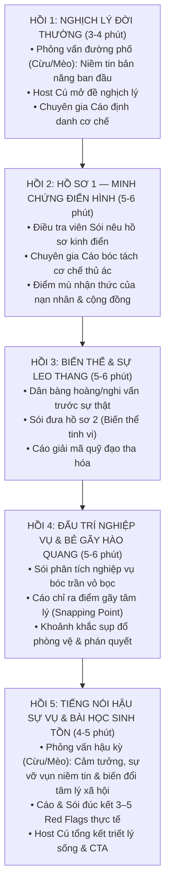
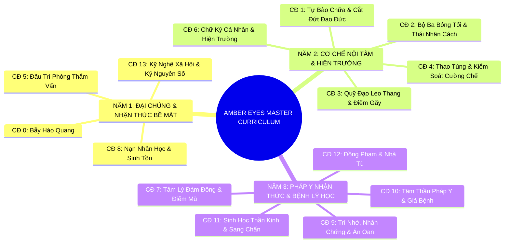
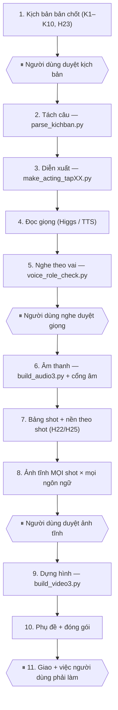

# KẾ HOẠCH KHUNG TỔNG THỂ CHO TOÀN BỘ CÁC CHUYÊN ĐỀ
## KÊNH YOUTUBE AMBER EYES (MASTER BLUEPRINT: 14 CHUYÊN ĐỀ — 140 TẬP)

> **Mục tiêu:** Chuẩn hóa toàn diện kiến trúc sản xuất cho toàn bộ 14 Đại Chuyên Đề (140 tập) trong [KhoChuyenDe_TamLyHocToiPham.md](file:///d:/TEST/Gax/amber-eyes/00_TIEU_CHUAN/KhoChuyenDe_TamLyHocToiPham.md), lấy khuôn mẫu phương pháp luận từ [KeHoach_TongThe_ChuyenDe_BayHaoQuang.md](file:///d:/TEST/Gax/amber-eyes/00_TIEU_CHUAN/KeHoach_TongThe_ChuyenDe_BayHaoQuang.md) làm chuẩn mực xương sống.

---

## PHẦN I: MA TRẬN PHƯƠNG PHÁP LUẬN CHUẨN HÓA (THE UNIFIED FORMULA)

Mọi chuyên đề trong kho 14 chuyên đề đều phải tuân thủ nghiêm ngặt **3 trục chuẩn mực**:

### 1. Trục Triết Lý Nội Dung
* **Lấy cơ chế tâm lý học làm xương sống:** Tuyệt đối không làm phóng sự án giật gân, không kể lể tuần tự vụ việc đơn thuần.
* **Hồ sơ vụ án thực tế là vật chứng minh họa:** Mỗi tập sử dụng 2 hồ sơ (Hồ sơ 1 điển hình $\rightarrow$ Hồ sơ 2 biến thể/leo thang).
* **Chiếu rọi qua lăng kính đời thường:** Luôn kéo người xem về thực tại (gia đình, công sở, tình cảm, mạng xã hội) để người xem thấy chính mình hoặc người xung quanh trong đó.
* **Chuẩn mực đạo đức & Tuân thủ YouTube (V9):** Tuyệt đối không mô tả chi tiết giải phẫu thi thể, không tình dục hóa, không bạo lực máu me; tập trung vào cuộc chiến tâm lý.

---

### 2. Hệ Thống 4 Tầng Nhận Thức & Giọng Đọc (Cast Matrix)

| Vai | Nhân vật / Hình tượng | Vai trò chức năng | Nhiệm vụ bắt buộc trong từng tập | Giọng đọc |
|---|---|---|---|---|
| **Host** | **Cú Trầm** (Trầm ấm, chiêm nghiệm, triết lý) | Dẫn dắt & Đúc kết nhân sinh | Đặt câu hỏi mở đầu về nghịch lý xã hội, kết nối các hồi, chốt lại thông điệp nhân sinh ở Hồi 5. | Theo `CAST` / `EPISODES` trong `.work/edition.py` |
| **Dân** | **Cừu / Mèo** (Người dân đời thường, Vox Pop) | Góc nhìn Xã hội & Sự biến đổi tâm lý | • **Hồi 1 (Tiền sự vụ):** Bộc lộ định kiến ngây thơ của số đông ("người lịch sự thế sao ác được").<br/>• **Hồi 3 (Giữa sự vụ):** Hoang mang, kinh ngạc trước sự thật hé lộ.<br/>• **Hồi 5 (Hậu sự vụ - Post-Verdict Vox Pop):** Phát biểu cảm tưởng, bộc lộ sự **thức tỉnh và biến đổi nhận thức** (từ tin tưởng mù quáng $\rightarrow$ vỡ vụn niềm tin $\rightarrow$ tái định hình khiên chắn cảnh giác). | Theo `CAST` / `EPISODES` trong `.work/edition.py` |
| **Chuyên gia** | **Cáo Trắng** (Nữ trí thức, sắc bén, hàn lâm) | Bóc tách Cơ chế Tâm lý | Định danh hội chứng/cơ chế khoa học (DSM-5, Bandura, Cialdini...), phân tích sự biến dạng nhận thức và bẫy tâm lý; soi chiếu sự chuyển biến tâm lý của cộng đồng hậu sự vụ. | Theo `CAST` / `EPISODES` trong `.work/edition.py` |
| **Điều tra viên**| **Sói Xám** (Lạnh lùng, thực chiến, đanh thép) | Thực chứng Nghiệp vụ & Vụ án | Đưa ra hồ sơ án thực tế, kỹ thuật thu thập dấu vết hành vi, chiến thuật đấu trí tại phòng thẩm vấn hoặc hiện trường. | Theo `CAST` / `EPISODES` trong `.work/edition.py` |

---

> Giọng **không ghi cứng trong kế hoạch**: engine hiện tại là Higgs (`QUY_TAC_AUDIO_HIGGS.md`); đổi giọng phải qua G8–G13 và người dùng đồng ý (L4). Vai người dân gồm **2 vai riêng N1 (Cừu), N2 (Mèo)** ⇒ tổng **5 vai**.

### 3. Công Thức Bố Cục 5 Hồi Chuẩn Hóa (5-Act Formula Blueprint)
*Mỗi tập kéo dài 20 – 25 phút (~2.500 – 3.200 từ), phân bổ thời lượng như sau:*



#### Chi Tiết Cơ Chế "Biến Đổi Tâm Lý Người Dân" (The 3-Stage Public Psychological Shift)
Mắt xích phỏng vấn người dân (Cừu / Mèo) được thiết kế khép kín thành **chu kỳ chuyển hóa tâm lý 3 giai đoạn**:
1. **Giai đoạn 1 (Hồi 1 - Trước sự vụ / The Naive Bias):** Thái độ ngây thơ, phòng vệ bằng định kiến tích cực (*"Trông anh ấy lịch sự, học thức thế làm sao làm chuyện đó được?"*).
2. **Giai đoạn 2 (Hồi 3 - Giữa sự vụ / Cognitive Dissonance):** Cú sốc nhận thức, hoang mang, tự vấn (*"Nếu người như vậy mà còn làm được điều đó, thì xung quanh mình ai là người đáng tin?"*).
3. **Giai đoạn 3 (Hồi 5 - Hậu sự vụ / The Psychological Awakening):** 
   - **Phát biểu cảm tưởng:** Bày tỏ cảm giác rợn ngợp khi nhớ lại những tương tác đời thường trước đây với thủ phạm, cảm giác dằn vặt vì bản thân từng vô tình bỏ qua những dấu hiệu bất thường.
   - **Góc nhìn biến đổi tâm lý:** Nhận thức rõ ràng rằng sự an toàn không đến từ "vẻ ngoài tử tế" hay "danh xưng nghề nghiệp"; hình thành khiên chắn nhận thức mới: tỉnh táo, biết lắng nghe trực giác và tôn trọng các ranh giới cá nhân thay vì nể nang mù quáng.

---

### 4. Hệ Sinh Thái 10 Chỉ Dấu Tâm Lý & Hành Vi (Bắt buộc theo Tiêu chuẩn A2c & K10)
Trong mọi tập kịch bản của bất kỳ chuyên đề nào, kịch bản phải làm rõ đủ **10 chỉ dấu**:
1. **Ảnh hưởng & sự quan tâm xã hội:** Mức độ chấn động và tác động dư luận.
2. **Cách hung thủ nhìn nạn nhân:** Cơ chế biến nạn nhân thành công cụ/vật thể/đối tượng trừng phạt.
3. **Cách hung thủ nhìn người thân & chia ngăn (Compartmentalization):** Mặt nạ xã hội vs. con quỷ bên trong.
4. **Thái độ trước bản án/pháp luật:** Thách thức, đóng vai nạn nhân hay trơ trẽn.
5. **Hệ thống tự bào chữa (Moral Disengagement):** Kẻ ác tự ru ngủ lương tâm bằng lý lẽ gì.
6. **Ngòi nổ & điểm gãy tâm lý (The Snapping Point):** Giọt nước tràn ly kích hoạt tội ác.
7. **Dấu ấn Signature vs. Thủ đoạn MO:** Nhu cầu thỏa mãn tâm lý cố định vs. kỹ thuật gây án thích ứng.
8. **Quỹ đạo leo thang ảo tưởng (Escalation):** Từ vi phạm nhỏ, tưởng tượng lệch lạc đến án mạng.
9. **Hiệu ứng hào quang & điểm mù xã hội:** Xã hội đã vô tình tạo điều kiện cho thủ phạm ra sao.
10. **Nạn nhân học & cảnh báo đỏ sinh tồn (Victimology Red Flags):** Bài học thực tế để người xem tự bảo vệ.

---

## PHẦN II: KHUNG THIẾT KẾ CHI TIẾT 14 ĐẠI CHUYÊN ĐỀ (MASTER CURRICULUM)

Mỗi chuyên đề được cấu trúc thành **10 tập có tính hệ thống cao**, chuyển hóa từ lý thuyết hàn lâm sang bối cảnh đời thường:



---

### GIAI ĐOẠN 1: THIẾT LẬP THƯƠNG HIỆU & HÚT KHÁN GIẢ ĐẠI CHÚNG (NĂM 1 — 40 TẬP)

#### 1. Chuyên Đề 0: Bẫy Hào Quang & Ảo Tưởng Thủ Ác (The Halo Effect Series)
* **Trọng tâm:** 10 bối cảnh đời thường che đậy tội ác bằng hào quang địa vị, đạo đức giả và sự tử tế giả tạo.
* **Cặp hồ sơ tiêu biểu:**
  * Công sở (Bernard Madoff / Richard Scrushy)
  * Mạng xã hội/Hẹn hò (Simon Leviev "Tinder Swindler" / John Meehan "Dirty John")
  * Hàng xóm gương mẫu (John Wayne Gacy / Dennis Rader "BTK")
  * Áo blouse trắng (Harold Shipman / Michael Swango)
  * Lòng trắc ẩn giả lập (Ted Bundy / kẻ giả gãy tay xin bê đồ)
* **Kết quả đầu ra:** Bộ cẩm nang phá vỡ điểm mù "nhìn mặt bắt hình dong".

#### 2. Chuyên Đề 5: Đấu Trí Tại Phòng Thẩm Vấn (Forensic Interrogation Series)
* **Trọng tâm:** Cuộc chiến tâm lý không tiếng súng giữa Sói và Nghi phạm; giải ảo ngôn ngữ cơ thể, bóc trần lời thú tội giả và kỹ thuật SUE/Cognitive Load.
* **Cặp hồ sơ tiêu biểu:**
  * Kỹ thuật Reid vs. Lời thú tội giả (Central Park Five / Brendan Dassey)
  * Kỹ thuật Mr. Big (Chiến dịch trinh sát Canada phá án mạng máu lạnh)
  * Đọc vị kịch bản dối trá qua CBCA/SVA (Chris Watts / Casey Anthony)
  * Kể ngược dòng thời gian phá vỡ kịch bản dựng sẵn (Jodi Arias)
* **Kết quả đầu ra:** Kỹ năng phân biệt sự thật và dối trá dựa trên cơ sở khoa học nhận thức, xóa bỏ mê tín "nhìn ánh mắt đoán nói dối".

#### 3. Chuyên Đề 8: Nạn Nhân Học & Cẩm Nang Sinh Tồn (Victimology & Survival Series)
* **Trọng tâm:** Trao quyền tự vệ tâm lý; cơ chế trực giác nguy hiểm (The Gift of Fear), bẫy lịch thiệp và phản ứng đóng băng sinh học (Freeze & Fawn).
* **Cặp hồ sơ tiêu biểu:**
  * Thoát hiểm nhờ trực giác (Nạn nhân sống sót của Ted Bundy / Robert Hansen)
  * Cái giá của sự lịch thiệp (Mary Vincent / các nạn nhân bị kẻ xấu thao túng sự ngại ngùng)
  * Bẫy lòng tốt cưỡng ép & Lời hứa chưa từng yêu cầu (Gavin de Becker caseworks)
* **Kết quả đầu ra:** Bộ quy tắc phản xạ đỏ (Red Flags) bảo vệ tính mạng trong không gian công cộng và riêng tư.

#### 4. Chuyên Đề 13: Kỹ Nghệ Xã Hội & Tội Phạm Kỷ Nguyên Số (Cyberpsychology Series)
* **Trọng tâm:** Khi tội phạm khai thác lỗ hổng trong tâm lý con người thay vì mã độc máy tính; bẫy mổ heo, deepfake và sextortion.
* **Cặp hồ sơ tiêu biểu:**
  * Bẫy mổ heo xuyên biên giới (Đại án các khu phức hợp lừa đảo Đông Nam Á)
  * Tống tiền tình dục kỹ thuật số & Bi kịch học đường (Vụ án Sextortion thanh thiếu niên)
  * Deepfake bắt cóc ảo mạo danh người thân (Vụ lừa đảo gia đình công nghệ cao)
* **Kết quả đầu ra:** Khiên chắn bảo vệ tinh thần và tài sản trước các cạm bẫy tâm lý số 4.0.

---

### GIAI ĐOẠN 2: MỔ XẺ CƠ CHẾ NỘI TÂM & PHÂN TÍCH HIỆN TRƯỜNG (NĂM 2 — 50 TẬP)

#### 5. Chuyên Đề 4: Nghệ Thuật Thao Túng & Kiểm Soát Cưỡng Chế (Coercive Control Series)
* **Trọng tâm:** Dạng bạo lực vô hình không để lại vết bầm; Trauma Bonding, Gaslighting, DARVO và chu kỳ Lạm dụng.
* **Cặp hồ sơ tiêu biểu:**
  * Khí độc thao túng gia đình (Vụ án Sally Challen / Gypsy Rose Blanchard)
  * Kỹ thuật DARVO của những kẻ ái kỷ quyền lực (Vụ kiện Johnny Depp - Amber Heard qua góc nhìn pháp y)
  * Tà đạo độc đoán bẻ gãy ý chí (Jonestown Jim Jones / NXIVM Keith Raniere)
* **Kết quả đầu ra:** Nhận diện và thoát khỏi những mối quan hệ độc hại thao túng tinh thần.

#### 6. Chuyên Đề 6: Chữ Ký Cá Nhân & Hiện Trường Biết Nói (Behavioral Profiling Series)
* **Trọng tâm:** Hiện trường không chỉ có ADN mà chứa đựng dấu vết tâm lý; phân định MO vs. Chữ ký, Dàn dựng hiện trường (Staging) và Hành vi hoàn tác (Undoing).
* **Cặp hồ sơ tiêu biểu:**
  * MO thay đổi nhưng Chữ ký bất biến (Jack the Ripper / The Boston Strangler)
  * Dàn dựng tự sát giả bị bóc trần (Vụ án Scott Peterson / Kathleen Peterson)
  * Hành vi hoàn tác lau rửa thi thể thể hiện mối quan hệ thân thuộc (Vụ án nội tộc)
* **Kết quả đầu ra:** Khả năng đọc vị tâm lý con người qua những dấu vết hành vi để lại trong đời sống.

#### 7. Chuyên Đề 2: Bộ Ba Bóng Tối & Phổ Thái Nhân Cách (Dark Triad Series)
* **Trọng tâm:** Phân biệt Thái nhân cách nguyên phát vs. thứ phát; Ái kỷ ác tính, Machiavelli và Kẻ ác dâm đời thường (Everyday Sadism).
* **Cặp hồ sơ tiêu biểu:**
  * Thước đo PCL-R của Robert Hare áp dụng cho kẻ sát nhân (Ted Bundy / Jeffrey Dahmer)
  * Kẻ thái nhân cách thành đạt trong kinh doanh (Vụ án sụp đổ Enron)
  * Ái kỷ dạng ẩn đóng vai nạn nhân (Vụ án Jodi Arias)
* **Kết quả đầu ra:** Chuẩn mực hóa kiến thức DSM-5, nhận diện các mối nguy tiềm ẩn mà không kỳ thị bệnh lý tâm thần.

#### 8. Chuyên Đề 1: Cơ Chế Tự Bào Chữa & Cắt Đứt Đạo Đức (Moral Disengagement Series)
* **Trọng tâm:** Học thuyết Albert Bandura: Cách bộ não của kẻ thủ ác biện minh, phi nhân hóa nạn nhân và chia ngăn để làm điều ác mà vẫn ngủ ngon.
* **Cặp hồ sơ tiêu biểu:**
  * Phi nhân hóa nạn nhân biến người thành đồ vật (Jeffrey Dahmer / David Parker Ray)
  * "Tôi chỉ làm theo lệnh" (Phiên tòa Nuremberg / Adolf Eichmann)
  * Đổ lỗi cho nạn nhân & Lên án người lên án (Aileen Wuornos)
* **Kết quả đầu ra:** Thấu suốt cách cái ác tự ngụy biện trong xã hội và trong chính nội tâm mỗi người.

#### 9. Chuyên Đề 3: Quỹ Đạo Leo Thang & Điểm Gãy Tâm Lý (Escalation & Snapping Point)
* **Trọng tâm:** Tội ác không bắt đầu từ số 100; tam giác Macdonald, từ nhìn trộm leo thang đột nhập, bám đuôi (Stalking) và kẻ tích tụ bất công.
* **Cặp hồ sơ tiêu biểu:**
  * Quỹ đạo bám đuôi dẫn đến án mạng (Vụ án Rebecca Schaeffer / Richard Farley)
  * Kẻ tích tụ bất công và điểm gãy bộc phát (Vụ xả súng công sở trường học)
  * Cơn nghiện thoát tội thách thức cảnh sát (Zodiac / BTK)
* **Kết quả đầu ra:** Nhận diện các dấu hiệu leo thang từ sớm để can thiệp trước khi chạm tới điểm gãy bi kịch.

---

### GIAI ĐOẠN 3: ĐÀO SÂU PHÁP Y NHẬN THỨC & BỆNH LÝ HỌC CHUYÊN SÂU (NĂM 3 — 50 TẬP)

#### 10. Chuyên Đề 9: Tâm Lý Học Trí Nhớ, Nhân Chứng & Án Oan (Eyewitness Memory Series)
* **Trọng tâm:** Ký ức giả (Elizabeth Loftus), hiệu ứng tập trung vào vũ khí, tầm nhìn đường hầm của cảnh sát và bi kịch án oan.
* **Cặp hồ sơ tiêu biểu:**
  * Ký ức giả gieo rắc án oan (Vụ án George Franklin / Vụ án McMartin Preschool)
  * Nhận diện sai hàng nhận mặt và cứu rỗi từ ADN (Dự án The Innocence Project - ca Ronald Cotton)
* **Kết quả đầu ra:** Góc nhìn tỉnh táo trước những lời khai "chắc chắn 100%" và bài học về sự mong manh của ký ức.

#### 11. Chuyên Đề 10: Tâm Thần Học Pháp Y & Ranh Giới Bệnh Lý (Forensic Psychiatry Series)
* **Trọng tâm:** Ranh giới giữa tội phạm và bệnh nhân; Giả điên trốn tội (Malingering), Tiêu chuẩn M'Naghten, Hội chứng Munchausen ủy nhiệm.
* **Cặp hồ sơ tiêu biểu:**
  * Vạch trần màn kịch giả điên trốn án tử (Kenneth Bianchi "Hillside Strangler")
  * Người mẹ đầu độc con để nhận tình thương xã hội (Dee Dee Blanchard)
  * Hoang tưởng ám ảnh giết người (Vụ ám sát John Lennon / Mark David Chapman)
* **Kết quả đầu ra:** Hiểu đúng về trách nhiệm hình sự và tính nhân đạo trong giám định tư pháp.

#### 12. Chuyên Đề 11: Sinh Học Thần Kinh & Tâm Lý Học Phát Triển (Neurocriminology Series)
* **Trọng tâm:** Tội phạm sinh ra hay tạo ra? Chấn thương thùy trán, gen MAOA, trải nghiệm bất lợi thời thơ ấu (ACEs) và ngộ độc chì đô thị.
* **Cặp hồ sơ tiêu biểu:**
  * Vết sẹo thùy trán làm thay đổi nhân cách (Phineas Gage / Charles Whitman - Kẻ bắn tỉa tháp Texas)
  * Sang chấn tuổi thơ và chuỗi án mạng (Ed Kemper / Aileen Wuornos)
* **Kết quả đầu ra:** Cái nhìn sâu sắc về phòng ngừa tội phạm từ gốc rễ giáo dục mầm non và y tế công cộng.

#### 13. Chuyên Đề 12: Tâm Lý Đồng Phạm, Cộng Hưởng Điên Loạn & Nhà Tù (Co-offending Series)
* **Trọng tâm:** Điên loạn tay đôi (Folie à Deux), các cặp đôi sát nhân, tâm lý kẻ tiếp tay (Enabler) và sự tha hóa sau song sắt.
* **Cặp hồ sơ tiêu biểu:**
  * Cặp đôi sát nhân và động lực thao túng (Ian Brady & Myra Hindley / Paul Bernardo & Karla Homolka)
  * Thí nghiệm nhà tù Stanford và sự tha hóa của quyền lực (Philip Zimbardo)
* **Kết quả đầu ra:** Cảnh giác trước sự lôi kéo đồng lõa và thấu hiểu tác động của môi trường thể chế.

#### 14. Chuyên Đề 7: Tâm Lý Học Đám Đông & Điểm Mù Xã Hội (Crowd Psychology Series)
* **Trọng tâm:** Hiệu ứng người đứng xem (sự thật vụ Kitty Genovese), tòa án mạng ném đá giấu tay, hoảng loạn đạo đức và sự tầm thường của cái ác.
* **Cặp hồ sơ tiêu biểu:**
  * Sự thật đằng sau vụ án Kitty Genovese 1964 (Giải ảo phóng đại báo chí)
  * Bạo lực mạng đẩy nạn nhân đến cái chết (Các vụ án Cyberbullying chấn động)
  * Thí nghiệm phục tùng quyền lực Milgram
* **Kết quả đầu ra:** Giữ vững sự độc lập phán đoán, không bị cuốn vào cơn cuồng nộ hay sự vô cảm tập thể.

---

## PHẦN III: QUY TRÌNH KỸ THUẬT & DÂY CHUYỀN SẢN XUẤT (PIPELINE & QUALITY GATES)

> **Nguồn chuẩn duy nhất là `AGENTS.md` mục 2** (lệnh cụ thể: `TIEU_CHUAN_DUNG_VIDEO.md` mục A3). Bảng dưới chỉ là bản tóm tắt để lập kế hoạch chuyên đề — nếu lệch với `AGENTS.md` thì **`AGENTS.md` thắng**. Quy trình **có cổng và có 4 mốc dừng chờ người dùng**, KHÔNG phải dây chuyền tự động khép kín: mỗi bước chỉ làm khi bước trước **ĐẠT**, không nhảy cổng.

Mọi lệnh chạy với `AE_EP=XX` (+ `AE_LANG=..` cho bản ngôn ngữ khác); cấu hình tập nằm trong `EPISODES` của `.work/edition.py`, **cấm sửa script riêng cho một tập** (L8).



| Bước | Việc | ĐẠT khi (đo bằng số, L3) |
|---|---|---|
| 1 | **Kịch bản — bản tốt nhất, chốt trước bảng shot (H23)** | Dữ kiện người thật đối chiếu nguồn công khai, ghi link trong bản review (K1); câu trích nguyên văn có nguồn (K2); không gán lời bịa cho người thật — vai người dân là **nhân vật minh hoạ**, dẫn bằng "hãy hình dung…" (K3); 0 lỗi V9, 0 chi tiết tình dục liên quan vị thành niên (K4); không khẳng định chẩn đoán người thật (K5); đủ 10 chỉ dấu (K10, A2c); **⏸ người dùng duyệt** |
| 2 | Tách câu `parse_kichban.py` | Số câu, số câu N1/N2 khớp Phụ lục A của hồ sơ tập |
| 3 | Diễn xuất `make_acting_tapXX.py` | Lời đọc khớp từng chữ câu gốc (G6); có `_pause_after` **cho từng ngôn ngữ**, `qc_pause_gate.py --pre` ĐẠT, 0 mã câu lạ (A13) |
| 4 | Đọc giọng (Higgs theo `QUY_TAC_AUDIO_HIGGS.md` / `QUY_TAC_HIGGS_MAC.md`) | Đủ 100% câu; CER < 2% từng vai (G12); `qc_voice_sentence.py`: 0 REGEN, 0 TRIM (A14 tầng 1). Tác vụ dài: kiểm log ≤ 30 phút/lần (L11) |
| 5 | **Nghe theo vai** `voice_role_check.py` (G10) | Mỗi vai nghe ra **1 người**, **5 vai** (Host, Điều tra viên, Chuyên gia, N1, N2) tách bạch — vai người dân nay nói ở 3 hồi nên N1/N2 phải qua đủ G8–G9 · **⏸ người dùng nghe duyệt; không đạt ⇒ DỪNG** |
| 6 | Âm thanh `build_audio3.py` | 0 câm > 0,3 s @ −60 dB · −16 ± 1 LUFS · đỉnh ≤ −1,5 dBFS (limiter `latency=1`, A7) · lời đầu 22,8–23,5 s · nhịp nghỉ trung vị ≥ 0,6 s, ≤ 25% < 0,4 s (A13) · `qc_wave_gate.py` ĐẠT (H24) · `qc_voice_gap.py` ĐẠT (A14 tầng 2) |
| 7 | Bảng shot `parse_shots.py` — **nền lập theo shot (H25)** | Phủ 100% câu đúng thứ tự; `qc_bg_usage.py --plan` ĐẠT trước khi viết prompt; sinh đủ ảnh (Kaggle FLUX, H21) rồi mới parse; soi 100% nền mới (H2/H19); `qc_bg_usage.py` ĐẠT (H22) |
| 8 | **Ảnh tĩnh mọi shot × mọi ngôn ngữ** `build_video3.py --stills` | Không chữ lạ ngoài thẻ kết/số T5, không lộ mặt (H1/H26); soi 100% nền mới (H2/H19) · **⏸ người dùng duyệt** |
| 9 | Dựng hình `build_video3.py --workers 6` | `picture.mp4` = `timeline.total` ± 0,05 s; `timeline.total` = thời lượng master (T20); đổi audio ⇒ parse shot + dựng lại (H14) |
| 10 | Phụ đề + đóng gói `subtitles.py`, `package.py --mux` | Hình = tiếng ± 0,05 s; giải mã 0 lỗi; thumbnail đúng tập (H11); thẻ kết có chữ (H12); hash/mtime file trước mux (T17); mô tả ≤ 5.000 ký tự, không `[PENDING]` (T15) |
| 11 | Giao | Báo số đo + **⏸ danh sách việc người dùng phải làm** (nguồn, điều khoản, nghe/xem duyệt) |

**Cấm xuyên suốt:** tốn tiền / đổi giọng / dùng tài sản ngoài / ghi đè thành phẩm khi chưa hỏi (L4) · ghi đè khi chưa sao lưu `.work/_cu/` (L5) · tài sản không có dòng `provenance.json` (L7) · commit media (L10).

### Phong cách hình (giữ nguyên định hướng)
* Graphic novel noir u tối, tương phản cao, hổ phách + xám than; nền vụ án toàn khung, linh thú nhỏ ở góc.
* Người thật chỉ dạng bóng, mặt chìm hoàn toàn; **không vẽ nạn nhân** vụ xâm hại/giết người (H1). Vai người dân minh hoạ bằng micro/bóng, không phải người thật.

---

## PHẦN IV: DANH MỤC TÀI LIỆU CẦN ĐẶT TÊN & TỔ CHỨC FILE TRONG DỰ ÁN

Để quản lý 140 tập không bị xung đột hay quá tải thư mục, hệ thống quản trị file tuân theo cấu trúc sau:

```
00_TIEU_CHUAN/
  ├── KhoChuyenDe_TamLyHocToiPham.md             (Mục lục tổng quan 140 tập)
  ├── KeHoach_TongThe_ChuyenDe_BayHaoQuang.md     (Kế hoạch mẫu CĐ 0)
  ├── KeHoach_Khung_TongThe_14_ChuyenDe.md        (Bản blueprint này)
  └── KeHoach_ChiTiet_ChuyenDe_XX.md             (Chi tiết từng CĐ khi triển khai)

01_KICH_BAN/
  └── ChuyenDe_XX/
      ├── Tap01_TenTap/                          (Kịch bản, acting, prompt hình)
      └── ...

02_SAN_XUAT/
  └── ChuyenDe_XX/
      ├── Tap01/                                 (Audio, shots, timeline, mux)
      └── ...
```

---

## PHẦN V: KẾT LUẬN & BƯỚC TRIỂN KHAI TIẾP THEO

Bản kế hoạch chung này thiết lập **bộ gen định danh (DNA) bất biến** cho Amber eyes:
1. Mỗi tập phim là một **bài giảng tâm lý học hành vi thực chiến** chứ không đơn thuần là vụ án gián đoạn.
2. Khán giả xem xong không chỉ thỏa mãn trí tò mò mà mang về **cẩm nang tự vệ tâm lý** trong cuộc sống hàng ngày.
3. Toàn bộ dây chuyền sản xuất được chuẩn hóa thành công thức, sẵn sàng cho việc tăng tốc sản xuất hàng loạt theo lộ trình 3 năm đề ra.
