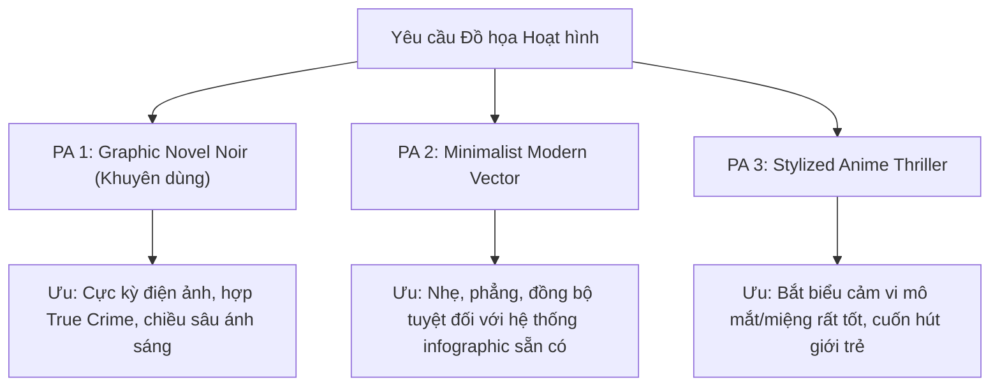
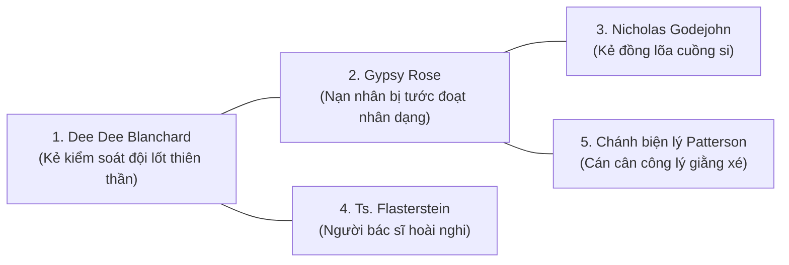

# PHƯƠNG ÁN THIẾT KẾ TẠO HÌNH HOẠT HÌNH 5 NHÂN VẬT — TẬP 01
**Dự án:** Podcast / Audio Tài liệu Phân tích Tâm lý học Tội phạm  
**Tập 01:** *Độc Dược Nhân Danh Tình Mẹ (Hội chứng Münchausen qua trung gian — Vụ án Dee Dee & Gypsy Rose Blanchard)*  
**Tài liệu liên quan:** [kichban_tap01_22102026.md](file:///d:/TEST/Gax/Audi/kichban_tap01_22102026.md) · [KeHoach_LamLai_Video_Tap01.md](file:///d:/TEST/Gax/Audi/KeHoach_LamLai_Video_Tap01.md)

---

## 1. TỔNG QUAN YÊU CẦU & BÀI TOÁN THIẾT KẾ

Kịch bản **Tập 01** là một tác phẩm tâm lý tội phạm sâu sắc, nặng về tư liệu y khoa và bi kịch gia đình có thật. Do đó, việc sử dụng phong cách **hoạt hình (stylized animation)** cần giải quyết đồng thời 3 bài toán lớn:

1. **Tính chất nghiêm túc của thể loại (True Crime / Profiling):** Tránh biến vụ án thành "phim hoạt hình trẻ em" hay biếm họa phản cảm; phải giữ được sự tôn trọng nạn nhân, tính trang nghiêm của pháp lý và chiều sâu phân tích tâm thần học.
2. **Khả năng phân biệt tức thì (Instant Recognition):** Mỗi nhân vật phải có một **Silhouette (bóng dáng)**, **bảng màu (Color Palette)** và **đạo cụ biểu tượng (Signature Prop)** độc nhất. Khán giả chỉ cần nhìn lướt trong 0,3 giây là biết ai đang nói hoặc ai đang xuất hiện, không bị nhầm lẫn dù xem trên màn hình điện thoại nhỏ.
3. **Tính hài hòa khi ghép video (Compositing Harmony):** Giữ vững không gian u ám, điện ảnh của câu chuyện vụ án làm nền canvas xuyên suốt 100% thời lượng. Các nhân vật chỉ xuất hiện ở **dạng bán thân nhỏ gọn (Bust Cutout / Overlay Badge)** tại góc màn hình. Đảm bảo đường nét noir và viền sáng (Rim Light) của nhân vật hòa quyện tự nhiên với bối cảnh tối của vụ án, không làm vỡ mạch cảm xúc trinh thám rùng rợn.

### Phân định hai tầng nhân vật trong dự án

Để đáp ứng trọn vẹn cả cấu trúc sản xuất video lẫn nội dung kịch bản, đề án này phân tích chi tiết cho cả 2 tầng:

- **Tầng Ekip dẫn chuyện (5 nhân vật theo kế hoạch sản xuất):** Host, Điều tra viên, Chuyên gia tâm lý, Nhân chứng Hàng xóm (N1), Khán giả dư luận (N2).
- **Tầng Diễn biến vụ án (5 nhân vật trọng tâm của câu chuyện):** Dee Dee Blanchard (Mẹ), Gypsy Rose Blanchard (Con gái), Nicholas Godejohn (Bạn trai), Tiến sĩ Bernardo Flasterstein (Bác sĩ nhi khoa phát hiện nghi vấn), Dan Patterson (Chánh biện lý đại diện pháp lý).

---

## 2. BA PHƯƠNG ÁN PHONG CÁCH ĐỒ HỌA HOẠT HÌNH (ART STYLES)

> [!IMPORTANT]
> **ĐỊNH HƯỚNG ĐÃ PHÊ DUYỆT:** Bạn đã chính thức lựa chọn **Phương án 1: Graphic Novel Noir** kết hợp kiến trúc bố cục **Nền u ám câu chuyện (16:9) làm trục chính + Nhân vật bán thân dạng nhỏ (Bust Cutout / Overlay Badge)** đặt ở góc màn hình. Các phương án khác được lưu lại để tham khảo so sánh.



---

### PHƯƠNG ÁN 1: GRAPHIC NOVEL NOIR (TRUYỆN TRANH ĐIỆN ẢNH TỐI) — *(ĐỀ XUẤT TỐI ƯU)*

> [!TIP]
> **Đây là phương án phù hợp nhất cho kênh Podcast Tâm lý học Tội phạm.** Phong cách này kết hợp giữa nghệ thuật truyện tranh Âu-Mỹ trưởng thành và ánh sáng tương phản rạp chiếu, tạo ra không khí nghẹt thở, sang trọng và bí ẩn.

- **Cảm hứng thị giác:** *Arcane* (phần ánh sáng góc cạnh), *The Wolf Among Us*, *Batman: The Animated Series*, *Disco Elysium*, *Love Death & Robots*.
- **Đặc trưng đường nét & khối:**
  - Nét mực vẽ tay (ink line-art) đậm, dứt khoát ở viền ngoài, đường nét bên trong thanh mảnh.
  - Tỷ lệ cơ thể chuẩn giải phẫu (Semi-realistic), không phóng đại chibi.
  - Đổ bóng mảng khối tương phản cao (**Chiaroscuro**): một nửa khuôn mặt luôn chìm trong bóng tối để tạo vẻ bí ẩn, giảm thiểu nhu cầu nhép môi phức tạp.
- **Xử lý ánh sáng:** Sử dụng **Rim Light (ánh sáng ven)** có màu sắc đặc trưng viền quanh tóc, vai và đường nét gò má của mỗi nhân vật.
- **Độ hòa hợp video:** Đồng điệu 100% với nhạc nền Solo Cello, tiếng đàn Music Box ma mị và tiếng Sub-bass drone trong kịch bản.

---

### PHƯƠNG ÁN 2: MINIMALIST MODERN VECTOR GRAIN (VECTOR TỐI GIẢN PHỦ HẠT CỔ ĐIỂN)

- **Cảm hứng thị giác:** Phim hoạt hình tài liệu *Waltz with Bashir*, đồ họa điều tra của *Vox / Kurzgesagt* (bản Dark Mode), game *Gris*.
- **Đặc trưng đường nét & khối:**
  - Nhân vật dựng bằng các khối hình học phẳng (Flat Vector Shapes), lược bỏ tối đa chi tiết vụn vặt.
  - Mặt có thể tinh giản ngũ quan hoặc chỉ vẽ sống mũi, viền cằm và gọng kính; không vẽ mắt miệng chi tiết (phù hợp tuyệt đối với quy tắc không cần lip-sync).
  - Phủ một lớp bề mặt mịn giả chất liệu giấy mỹ thuật (**Paper Texture / Film Grain 5%**) giúp các mảng màu phẳng không bị khô cứng.
- **Độ hòa hợp video:** Dễ dàng tích hợp với các bảng Infographic, sơ đồ bệnh án DSM-5, mốc thời gian Timeline và bảng ghim dây đỏ mà mã nguồn Python (Pillow) của dự án đang chạy.

---

### PHƯƠNG ÁN 3: STYLIZED ANIME PSYCHOLOGICAL THRILLER (HOẠT HÌNH TÂM LÝ LY KỲ PHONG CÁCH SEINEN)

- **Cảm hứng thị giác:** *Monster* (tác phẩm kinh điển về tâm lý tội phạm của Naoki Urasawa), *Death Note*, *Psycho-Pass*.
- **Đặc trưng đường nét & khối:**
  - Đường nét thanh thoát, ánh mắt rất có hồn và lột tả nội tâm cực sâu (ánh mắt đờ đẫn của Gypsy, ánh mắt thao túng của Dee Dee, ánh mắt sắc sảo của Chuyên gia).
  - Bảng màu khử bão hòa (Desaturated/Muted Colors), pha nhiều sắc xám lạnh, tím than và xanh rêu.
- **Độ hòa hợp video:** Rất ăn khách trên YouTube với tệp khán giả trẻ; tạo sự đồng cảm mạnh mẽ (empathy) khi quay cận cảnh vào ánh mắt các nhân vật lúc bi kịch lên đỉnh điểm.

---

## 3. THIẾT KẾ CHI TIẾT 5 NHÂN VẬT — TẦNG EKIP DẪN CHUYỆN

Để người xem không bị nhầm lẫn giữa 5 người nói, mỗi người được định hình theo một **"Bộ mã nhận diện"** gồm: Hình khối cơ thể, Trang phục, Đạo cụ và Ánh sáng môi trường riêng biệt.

```
┌─────────────────────────────────────────────────────────────────────────────────────────┐
│                      MA TRẬN NHẬN DIỆN LINH THÚ TRINH THÁM NOIR                         │
├──────────────┬──────────────────┬─────────────────┬─────────────────────────────────────┤
│ NHÂN VẬT     │ LOÀI LINH THÚ    │ TRANG PHỤC / CỤ │ MÀU ÁNH SÁNG VEN (RIM LIGHT)        │
├──────────────┼──────────────────┼─────────────────┼─────────────────────────────────────┤
│ 1. Host      │ Cú mèo Tri thức  │ Áo len + Micro  │ Hổ phách ấm (Amber #E2B467)         │
│ 2. Điều tra  │ Sói xám Truy vết │ Măng-tô + Còng  │ Xanh thép lạnh (Cold Blue #86A9CC)  │
│ 3. Chuyên gia│ Cáo thông thái   │ Blazer + Kính   │ Tím suy tưởng (Violet #A99BD6)      │
│ 4. Hàng xóm  │ Cừu non lương thi│ Khăn len ôm ngực│ Nâu cát ấm (Sand #D9B99B)           │
│ 5. Khán giả  │ Mèo con tò mò    │ Hoodie + Màn TV │ Xanh lơ kỹ thuật số (Cyan #6E8CA0)  │
└──────────────┴──────────────────┴─────────────────┴─────────────────────────────────────┘
```

### ALBUM BẢN VẼ CONCEPT ĐÃ TẠO

````carousel

<!-- slide -->

<!-- slide -->

<!-- slide -->

<!-- slide -->

<!-- slide -->

<!-- slide -->

````

### BỘ HÌNH NHÂN VẬT CHÍNH THỨC — ĐÃ SẢN XUẤT (CAST v2.0 · 22/10/2026)

Bộ nhân vật dưới đây được sinh theo **đúng Master Prompt mục 6.1**, dùng engine tạo ảnh AI không watermark (các ảnh `*_concept.jpg` ở trên là bản khái niệm cũ, có watermark pollinations.ai — **không dùng để đưa vào video**).

Mỗi nhân vật có **2 file**:

- **Master** (`*.png`, 2048×2048, nền đen thuần) — bản gốc để in/dùng lại, tách nền lại khi cần.
- **Cutout** (`*_cutout.png`, 420×500, **nền trong suốt**, phần thân dưới fade dần vào đen) — file đưa vào overlay video, đúng khung ~420×500 mà mục 5.2 yêu cầu.

| Nhân vật | Master (2048×2048) | Cutout overlay (420×500) | Màu rim light |
|---|---|---|---|
| Cú Mèo Tri Thức (Host) | `assets/cast/host_owl_mascot.png` | `assets/cast/host_owl_mascot_cutout.png` | Amber `#E2B467` |
| Sói Xám Truy Vết (Điều tra viên) | `assets/cast/detective_wolf_mascot.png` | `assets/cast/detective_wolf_mascot_cutout.png` | Cold Blue `#86A9CC` |
| Cáo Thông Thái (Chuyên gia) | `assets/cast/psychologist_fox_mascot.png` | `assets/cast/psychologist_fox_mascot_cutout.png` | Violet `#A99BD6` |
| Cừu Non Lương Thiện (Nhân chứng) | `assets/cast/neighbor_sheep_mascot.png` | `assets/cast/neighbor_sheep_mascot_cutout.png` | Sand `#D9B99B` |
| Mèo Con Tò Mò (Khán giả) | `assets/cast/observer_cat_mascot.png` | `assets/cast/observer_cat_mascot_cutout.png` | Cyan `#6E8CA0` |

**Contact sheet kiểm tra hòa hợp:** `assets/cast/cast_contact_sheet.png` (và `.jpg`) — gồm hàng ảnh gốc + dải demo **Dạng 1: Floating Bust Cutout** đặt trên nền u ám để kiểm chứng viền sáng hòa vào nền video.

**Bóng nhân vật vụ án (mục 6.3) — đã sinh:** `assets/cast/silhouettes/sil_dee_dee.jpg` · `sil_gypsy.jpg` · `sil_nicholas.jpg` (16:9, phong cách noir đồng nhất).

> [!NOTE]
> **Quy trình tái lập:** `.work/make_cast_cutouts.py` — chạy `python .work/make_cast_cutouts.py` sẽ tái tạo toàn bộ Master + Cutout + Contact sheet từ các file nguồn. Pipeline: *chuẩn hoá nền trắng → đen (flood fill từ biên)* → *tách nền `rembg` (u2net)* → *cắt viền & cân 420×500* → *fade alpha phần dưới*.
> Các biến thể ảnh khi chọn (v2…v6) được giữ ở `.work/cast_variants/` để đối chiếu.

> [!TIP]
> **BA HƯỚNG TẠO HÌNH HOẠT HÌNH BIỂU TƯỢNG ĐỘC ĐÁO (ICONIC BRANDING):**
> 
> 1. **Hướng 1 — Linh thú Biểu tượng Noir (Animal Noir Mascot — Khuyên dùng):** Nhân cách hóa 5 vai trò thành linh vật trinh thám hoạt hình mặc âu phục (Host là **Cú/Quạ đen** thông thái đeo kính hổ phách, Điều tra viên là **Sói/Chó săn** măng-tô xanh thép, Chuyên gia là **Mèo đen/Cáo** blazer tím, Hàng xóm là **Cừu non**, Khán giả là **Tắc kè hoa**). Cực kỳ độc lạ, đậm chất biểu tượng thương hiệu (như *Blacksad, Rusty Lake, BoJack*), không thể nhầm lẫn.
> 2. **Hướng 2 — Hoạt hình 2D Ma mị (Dark Whimsical Cartoon):** Nhân vật hoạt hình cách điệu cao theo phong cách *Tim Burton / Gorillaz / Don't Starve* (mắt to phát sáng ma mị, cổ cao thanh mảnh, quai hàm sắc nhọn, áo len cổ lọ kéo cao che miệng). Rất nghệ thuật, ma mị và cuốn hút.
> 3. **Hướng 3 — Thực thể Mặt nạ Tâm lý (Abstract Rorschach Mask):** Nhân vật hoạt hình với chiếc đầu là mặt nạ vết mực tâm lý học tội phạm Rorschach biến đổi hình dạng theo cảm xúc câu chuyện. Tối giản, học thuật, bí ẩn đỉnh cao.

---

### 1. HOST (CÚ MÈO TRI THỨC — THE SCHOLARLY OWL)
- **Vai trò:** Người dẫn chuyện điềm tĩnh, trung lập, dẫn dắt thấu đáo suốt 60% thời lượng.
- **Tạo hình Bán thân (Bust Cutout 1:1):**
  - Linh thú cú mèo uyên bác, đầu hơi nghiêng góc 3/4, lông vũ màu xám tro pha nâu sẫm gọn gàng.
  - Điểm nhấn thị giác độc nhất: **Cặp kính tròn gọng kim loại phát sáng màu vàng hổ phách (`Amber #E2B467`)** nổi bật giữa bóng tối.
  - Trang phục: Áo len cổ lọ màu đen than chì (charcoal black turtleneck).
- **Đạo cụ & Ánh sáng ven:**
  - Micro boom arm kim loại cổ điển đặt chếch bên cạnh mỏ.
  - Viền sáng Rim Light màu hổ phách ấm (**Amber `#E2B467`**) ôm theo viền lông vũ và bờ vai.
  - **Dạng hiển thị trên video:** Tách nền trong suốt đặt ở góc dưới màn hình hoặc trong thẻ Badge sóng âm.

---

### 2. ĐIỀU TRA VIÊN (SÓI XÁM TRUY VẾT — THE NOIR WOLF DETECTIVE)
- **Vai trò:** Cung cấp hồ sơ pháp y, bằng chứng hiện trường, khẩu khí đanh thép, lạnh lùng (15% thời lượng).
- **Tạo hình Bán thân (Bust Cutout 1:1):**
  - Linh thú sói xám vai rộng, đường nét quai hàm góc cạnh đanh thép, ánh mắt sắc lẹm kiên định.
  - Trang phục: Áo khoác măng-tô xanh navy (`navy trench coat`) dựng cao cổ áo, đội chiếc mũ fedora trinh thám hơi nghiêng che nửa trán.
- **Đạo cụ & Ánh sáng ven:**
  - Tay cầm kẹp hồ sơ chứng cứ màu nâu dán nhãn `EVIDENCE`, huy hiệu cảnh sát bằng bạc giắt ngực.
  - Viền sáng Rim Light màu xanh thép lạnh (**Cold Blue `#86A9CC`**).
  - **Dạng hiển thị trên video:** Thẻ hồ sơ điều tra góc màn hình kết hợp dải sóng âm giọng đọc đanh thép.

---

### 3. CHUYÊN GIA TÂM LÝ (CÁO THÔNG THÁI — THE CUNNING FOX PROFILER)
- **Vai trò:** Mổ xẻ 3 tầng tâm lý bệnh hoạn của Dee Dee và cơ chế tê liệt ý chí của Gypsy (20% thời lượng).
- **Tạo hình Bán thân (Bust Cutout 1:1):**
  - Nữ linh thú cáo thanh lịch, ánh mắt điềm đạm, sâu thấu tâm can đối phương.
  - Điểm nhấn thị giác độc nhất: **Cặp kính mắt mèo (cat-eye glasses) phát sáng ánh tím dịu (`Violet #A99BD6`)**.
  - Trang phục: Áo blazer màu kem trang nhã cắt may chuẩn chỉnh.
- **Đạo cụ & Ánh sáng ven:**
  - Cầm chiếc bút máy kim loại và cuốn sổ tay da phân tích hội chứng DSM-5.
  - Viền sáng Rim Light màu tím suy tưởng (**Violet `#A99BD6`**).
  - **Dạng hiển thị trên video:** Thẻ Badge học thuật với biểu tượng não bộ thu nhỏ.

---

### 4. NHÂN CHỨNG HÀNG XÓM (CỪU NON LƯƠNG THIỆN — THE FRAGILE SHEEP WITNESS)
- **Vai trò:** Đại diện cho cộng đồng Springfield bị Dee Dee đánh lừa suốt 20 năm, giọng xúc động, chân chất (ở Hồi 1).
- **Tạo hình Bán thân (Bust Cutout 1:1):**
  - Linh thú cừu nhỏ nhắn, đôi tai rủ nhẹ, biểu cảm xúc động xót xa và bàng hoàng.
  - Trang phục: Quàng chiếc khăn len dệt kim dày ấm màu mộc che kín cổ.
- **Đạo cụ & Ánh sáng ven:**
  - Ánh sáng ven màu nâu cát ấm (**Sand `#D9B99B`**) như ngọn đèn hiên nhà hắt từ phía sau trong đêm xảy ra án mạng.
  - **Dạng hiển thị trên video:** Thẻ trích dẫn lời kể chân thật ở góc dưới màn hình.

---

### 5. KHÁN GIẢ HOÀI NGHI (MÈO CON TÒ MÒ — THE CURIOUS CAT OBSERVER)
- **Vai trò:** Đại diện cho công chúng theo dõi vụ án đặt câu hỏi hoài nghi then chốt: *"Tại sao Gypsy không đứng dậy tố cáo?"* (ở Hồi 4).
- **Tạo hình Bán thân (Bust Cutout 1:1):**
  - Linh thú mèo mặc áo hoodie xám sẫm trùm đầu, ngồi gù lưng tì hai tay lên cằm, đôi mắt to tròn mở lớn đầy trăn trở.
- **Đạo cụ & Ánh sáng ven:**
  - Ánh sáng ven màu xanh lơ kỹ thuật số (**Cyan `#6E8CA0`**) hắt ngược từ dưới lên như phản chiếu từ màn hình TV/laptop trong đêm.
  - **Dạng hiển thị trên video:** Khung câu hỏi hoài nghi đặt vấn đề cho vụ án.

---

## 4. THIẾT KẾ CHI TIẾT 5 NHÂN VẬT — TẦNG VỤ ÁN THỰC TẾ

Khi kịch bản đi vào các phân cảnh tái hiện hoặc phân tích tâm thần học, 5 nhân vật lịch sử của vụ án cần xuất hiện với tính ước lệ cao, đặc trưng hình họa cực kỳ sắc bén:



---

### 1. DEE DEE BLANCHARD (NGƯỜI MẸ MẮC HỘI CHỨNG FDIA)
- **Bản chất tâm lý:** Nghiện sự tôn sùng của đám đông, nhu cầu kiểm soát bệnh lý tuyệt đối, đóng vai "vị thánh tử đạo".
- **Đặc trưng thị giác:**
  - Thân hình đẫy đà, tròn trịa, chiếm diện tích lớn trong khung hình nhằm tạo cảm giác "ngột ngạt, đè nén" lên đứa con.
  - Khuôn mặt tròn, nụ cười phúc hậu giả tạo luôn đóng băng trên môi, nhưng đôi mắt mở to sắc lạnh, không chớp.
  - Trang phục: Những bộ đầm hoa vintage hoa nhí hoặc áo cổ bèo màu hồng nhạt cổ điển.
  - **Hành động biểu tượng:** Bàn tay to bè luôn nắm chặt lấy cổ tay hoặc đặt lên vai Gypsy — vừa giống như che chở nhưng thực chất là chiếc cùm gông cảnh cáo đứa con không được nói sai.

---

### 2. GYPSY ROSE BLANCHARD (NẠN NHÂN BỊ GIẢ BỆNH)
- **Bản chất tâm lý:** Bị tước đoạt sự trưởng thành (Infantilization), hội chứng bất lực tập nhiễm, sống trong nhà tù y tế.
- **Đặc trưng thị giác:**
  - Thân hình gầy gò, nhỏ thó, lọt thỏm trong chiếc xe lăn cơ khí cồng kềnh.
  - Đầu cạo trọc nhẵn thín (dấu vết hóa trị giả), thường đội những chiếc mũ len rộng thùng thình hoặc tóc giả búp bê xơ xác.
  - Gương mặt: Đôi mắt to tròn ngơ ngác đầy vẻ khiếp sợ; hàm răng cửa tiêu biến hoặc ố xỉn (do tác dụng phụ của thuốc chống động kinh không cần thiết); cặp kính cận to bản che nửa khuôn mặt.
  - Trang phục: Mặc những bộ váy xòe công chúa Disney sặc sỡ của trẻ con 7 tuổi dù thực tế đã ngoài 20 tuổi.
  - **Sự chuyển biến tạo hình (Hồi 5):** Khi cởi bỏ tóc giả, bước xuống khỏi xe lăn, mặc bộ quần áo phạm nhân màu cam giản dị — ánh mắt bỗng trở nên tự do, thanh thản lần đầu tiên trong đời.

---

### 3. NICHOLAS GODEJOHN (BẠN TRAI QUA MẠNG)
- **Bản chất tâm lý:** Hội chứng Asperger / Rối loạn phổ tự kỷ, cô độc, hoang tưởng hiệp sĩ cứu người đẹp, trượt vào ảo giác đôi (*Folie à Deux*).
- **Đặc trưng thị giác:**
  - Thân hình cao gầy, hơi gù, cổ rụt.
  - Gương mặt thất thần, râu ria lởm chởm không cạo, tóc bết lòa xòa trước trán.
  - Trang phục: Áo khoác hoodie tối màu kéo khóa kín cổ, bàn tay dài khẳng khiu luôn gõ phím hoặc ôm chiếc điện thoại phát sáng trong góc phòng tối.
  - Luôn được vẽ trong khung cảnh ánh sáng xanh neon u uất của màn hình chat mạng xã hội.

---

### 4. TIẾN SĨ BERNARDO FLASTERSTEIN (NGƯỜI BÁC SĨ HOÀI NGHI NĂM 2007)
- **Bản chất tâm lý:** Lương tâm nghề nghiệp và sự hoài nghi khoa học đối với hội chứng giả bệnh.
- **Đặc trưng thị giác:**
  - Bác sĩ lớn tuổi, tóc hoa râm, nét mặt nghiêm nghị, cương trực.
  - Đeo kính cận nửa vành trễ xuống sống mũi, áo blouse trắng tinh tươm có bảng tên và ống nghe quàng cổ.
  - **Hành động biểu tượng:** Cầm tập kết quả xét nghiệm âm tính đối chiếu với lời khai hoa mỹ của người mẹ, ngón tay gõ nhẹ lên trang hồ sơ ghi dòng chữ nghi vấn: *"Münchausen by Proxy?"*.

---

### 5. CHÁNH BIỆN LÝ DAN PATTERSON (ĐẠI DIỆN PHÁP LÝ & PHÁN QUYẾT)
- **Bản chất tâm lý:** Sự trăn trở giữa sự nghiêm minh của luật pháp và lòng trắc ẩn đối với một nạn nhân bị bạo hành 23 năm.
- **Đặc trưng thị giác:**
  - Người đàn ông trung niên mặc âu phục vest xám trang trọng, cà vạt màu đỏ rượu trầm.
  - Gương mặt góc cạnh cương nghị nhưng ánh mắt nhìn xuống đầy suy tư và trầm mặc trước bục nhân chứng.
  - **Hành động biểu tượng:** Đứng giữa hai biểu tượng: chiếc búa công lý của tòa án và chiếc xe lăn trống không bỏ lại phía sau.

---

## 5. NGUYÊN TẮC PHỐI GHÉP ĐỒ HỌA TRONG VIDEO (COMPOSITING HARMONY)

Để các nhân vật khi xuất hiện xen kẽ với tư liệu, chữ và biểu đồ không bị "chọi" nhau, toàn bộ video tuân thủ 4 nguyên tắc phối ghép sau:

### 1. Luật đồng bộ bảng màu (Palette Harmonization)
- **Nền môi trường chung:** Giữ tông đen than chì `ink` (`#0E0E11`) và xanh đêm `night` (`#151A2A`) xuyên suốt 5 hồi.
- **Màu vai chỉ sáng khi vai đó nói:** Khi Điều tra viên lên tiếng, mọi đường gạch chân, viền khung và sóng âm audio tự động chuyển sang màu `cold` (`#86A9CC`). Khi Host nói, chuyển về màu `amber` (`#E2B467`).
- **Màu hồng (`pink #E8A0BF`) là "Độc quyền của Vụ án":** Tuyệt đối không dùng màu hồng cho bất kỳ yếu tố nào thuộc về Host hay Điều tra viên. Màu hồng chỉ gắn liền với ngôi nhà 2103 North Volunteer, bóng dáng chiếc xe lăn và các ảo tưởng của Dee Dee.

### 2. Bố cục Video: Nền U Ám Xuyên Suốt + Nhân Vật Dạng Nhỏ (Overlay / PIP)

> [!IMPORTANT]
> **Nguyên tắc cốt lõi:** Nhân vật **KHÔNG** chiếm toàn màn hình làm gián đoạn câu chuyện. 
> Toàn bộ 100% diện tích màn hình là **không gian u ám, lạnh lẽo của vụ án** (ngôi nhà màu hồng, đèn cảnh sát, hồ sơ y tế, xe lăn bỏ không). Các nhân vật chỉ xuất hiện ở **dạng nhỏ gọn (Bust Cutout / Thẻ Badge bo góc)** tại một góc màn hình, đóng vai trò "dấu chỉ người nói" kết hợp sóng âm audio, giúp người xem luôn chìm đắm trong không khí trinh thám rùng rợn.

```
┌─────────────────────────────────────────────────────────────────────────────┐
│ 1920x1080 CINEMATIC CANVAS (NỀN U ÁM VỤ ÁN XUYÊN SUỐT, KHÔNG ĐỔI)           │
│                                                                             │
│  [Khung cảnh vụ án: Ngôi nhà hồng trong đêm / Phòng bệnh / Hồ sơ y khoa]   │
│  (Chuyển động camera chậm, lớp sương mờ hạt phim, giữ trọn không khí u tối)│
│                                                                             │
│                                                                             │
│                                                                             │
│ ┌──────────────────────┐                                                    │
│ │ [NHÂN VẬT DẠNG NHỎ]  │                                                    │
│ │ Bust Cutout / Badge  │     "DÒNG PHỤ ĐỀ / LUẬN ĐIỂM CHÍNH"               │
│ │ + Sóng âm giọng nói  │     (Chữ nổi bật trên nền tối vụ án)               │
│ └──────────────────────┘                                                    │
└─────────────────────────────────────────────────────────────────────────────┘
```

**Ba hình thức thể hiện nhân vật dạng nhỏ phù hợp:**
1. **Dạng 1: Floating Bust Cutout (Cắt nền trong suốt, hòa vào bóng tối):**
   - Nhân vật chỉ lấy từ ngực trở lên (Bust), tách nền trong suốt (`.png`).
   - Đặt khiêm tốn ở góc dưới-trái hoặc góc dưới-phải màn hình (kích thước ~ 420x500 px trên khung 1920x1080).
   - Phần thân dưới chìm dần vào bóng đen (Vignette gradient), chỉ có viền sáng Rim Light màu vai nhấp nháy nhẹ theo giọng nói.
2. **Dạng 2: Crime Dossier Card (Thẻ hồ sơ hiện đại bán trong suốt):**
   - Đóng trong khung thẻ chữ nhật bo góc nhỏ gọn (khoảng 380x120 px) ở góc trên-trái hoặc góc dưới-trái.
   - Chứa: Avatar tròn/oval 80 px + Tên vai (ĐIỀU TRA VIÊN / CHUYÊN GIA) + Dải sóng âm Audio thật (`showwaves`) nhảy theo biên độ âm thanh.
   - Nền thẻ màu xám than bán trong suốt 85% (`#1C1F2B`), nhìn thấu bối cảnh vụ án phía sau.
3. **Dạng 3: Chuyển vai mượt mà không cắt cảnh:**
   - Khi chuyển từ Host sang Điều tra viên hay Chuyên gia, khung cảnh vụ án phía sau **vẫn giữ nguyên hoặc chuyển động mượt mà (Pan/Push)**, chỉ có thẻ/avatar nhân vật ở góc tự động trượt ra (Slide out 0.3s) và nhân vật mới trượt vào (Slide in 0.3s). Không có hiện tượng giật màn hình.

### 3. Hiệu ứng động vi mô (Micro-motion) thay cho Lip-sync
- Thay vì làm cử động môi giả (dễ gây cảm giác Uncanny Valley khi nghe giọng AI), hệ thống áp dụng:
  - **Chuyển động Camera trên Khung nền Canvas 16:9:** Trượt từ từ (Slow Push-in $1.00 \to 1.05$ hoặc Slow Pan 40px) để duy trì cảm giác không gian rùng rợn, điện ảnh xuyên suốt câu chuyện.
  - **Nhịp thở nhẹ của Nhân vật (Breathing effect):** Nhân vật dạng nhỏ ở góc co giãn nhẹ nhàng $1.000 \leftrightarrow 1.006$ chu kỳ 4 giây tạo cảm giác có sự sống.
  - **Ánh sáng ven nhấp nháy theo âm lượng giọng đọc:** Khi giọng đọc nhấn mạnh vào từ khóa quan trọng, viền sáng màu vai bừng sáng nhẹ lên 15%.
  - **Sóng âm giọng thật (Audio Waveform):** Nhảy trực tiếp theo biên độ âm thanh thật của file thu âm, hiển thị sinh động theo từng nhịp nói.

---

## 6. BỘ PROMPT AI MẪU TẠO HÌNH (MIDJOURNEY / FLUX / STABLE DIFFUSION)

Để hiện thực hóa đúng kiến trúc **Nền u ám câu chuyện (16:9) + Nhân vật dạng nhỏ gọn (Bust Cutout / Overlay)**, hệ thống prompt được phân chia chuẩn xác thành 3 phần:

---

### 6.1 BỘ PROMPT TẠO 5 LINH THÚ TRINH THÁM NOIR (ANIMAL NOIR MASCOTS)

> [!NOTE]
> **Quy cách kỹ thuật định hình thương hiệu Linh thú:**
> - Nhân vật là **Linh thú hoạt hình biểu tượng mặc âu phục trinh thám noir**: Cú mèo, Sói xám, Cáo thông thái, Cừu non, Mèo con.
> - Điểm nhấn độc quyền: **Cặp kính hoặc chi tiết phát sáng (Glowing Accents)** kết hợp với đường viền sáng **Rim Light** mang màu nhận diện vai.
> - Nền: `pure solid black background` giúp tách nền PNG trong suốt hoặc hòa trộn thẳng vào góc tối video mà không lộ viền khung.

#### Prompt Master Linh thú Noir
```text
Iconic cartoon mascot bust portrait, anthropomorphic animal in vintage noir detective attire, chest-up view, dark graphic novel noir animation aesthetic, bold black ink linework, high contrast chiaroscuro, sharp colored glowing accents, isolated on pure solid black void background, clean silhouette edges for video overlay compositing, masterwork channel mascot --ar 1:1 --style raw
```

#### 1. Host (Cú mèo Tri thức — Kính phát sáng Hổ phách `#E2B467`)
```text
[Master Prompt], a wise scholarly anthropomorphic owl mascot, wearing a textured charcoal black turtleneck sweater, dark feathered head turned three-quarter angle, wearing sharp minimalist round spectacles that glow with bright warm golden amber light (Amber #E2B467), sleek boom-arm podcast microphone angled subtly beside beak, glowing amber rim light tracing feathers and shoulders against pitch-black void --ar 1:1
```

#### 2. Điều tra viên (Sói xám Truy vết — Huy hiệu & Viền thép lạnh `#86A9CC`)
```text
[Master Prompt], a gritty anthropomorphic grey wolf detective mascot, broad shoulders, wearing a dark navy trench coat with sharp turned-up collar and a tilted noir fedora hat, sharp muzzle and fierce intelligent eyes, intense sharp cold steel-blue rim light (Cold blue #86A9CC) carving geometric angles of coat and hat, holding a glowing silver police shield badge --ar 1:1
```

#### 3. Chuyên gia tâm lý (Cáo thông thái — Kính phát sáng Tím dịu `#A99BD6`)
```text
[Master Prompt], an elegant intellectual female anthropomorphic fox psychologist mascot, chic tailored cream blazer, delicate pointed ears, wearing sharp cat-eye spectacles that glow with an ethereal luminous violet light (Violet #A99BD6), holding a glowing silver fountain pen, soft violet rim light outlining her sleek fur and shoulders against black void --ar 1:1
```

#### 4. Nhân chứng Hàng xóm (Cừu non Lương thiện — Ánh sáng Màu Cát `#D9B99B`)
```text
[Master Prompt], a fragile gentle anthropomorphic sheep witness mascot, emotional sorrowful expression, clutching a thick knitted wool shawl close around her neck with furry hooves, warm rustic amber-sand rim light (Sand #D9B99B) softly outlining the textured wool and droopy ears like a distant porch lantern glow in the dark --ar 1:1
```

#### 5. Khán giả Dư luận (Mèo con Tò mò — Ánh sáng Xanh lơ TV `#6E8CA0`)
```text
[Master Prompt], a curious anthropomorphic young cat observer mascot, wearing an oversized dark charcoal hoodie with hood pulled over pointy ears, chin resting on paws, wide reflective eyes glowing with curiosity, dramatic upward cold cyan rim light (Cyan #6E8CA0) illuminating facial contours as if staring into a glowing television monitor in the dark --ar 1:1
```

---

### 6.2 BỘ PROMPT TẠO KHUNG NỀN U ÁM CÂU CHUYỆN (CINEMATIC CRIME CANVAS — 16:9)

> [!TIP]
> Đây là các khung hình 16:9 **chiếm trọn toàn màn hình**, làm nền xuyên suốt cho video. Không chứa nhân vật lớn để tránh che lấp nội dung, chỉ tập trung vào không gian, đồ vật và ánh sáng ma mị của vụ án.

#### Prompt Master Bối cảnh (16:9)
```text
Cinematic 16:9 wide shot, atmospheric criminal documentary backdrop, dark moody crime scene aesthetic, deep chiaroscuro lighting, subtle mist and film grain, desaturated muted color palette, ominous quiet tension, highly detailed, no people, no text, no watermark --ar 16:9 --style raw
```

#### Bối cảnh 1 (Hồi 1): Ngôi nhà màu hồng trong đêm mưa sương
```text
[Master Prompt], exterior wide angle shot of a small eerie single-story suburban house painted faded pale pastel pink (at 2103 North Volunteer Blvd) on a foggy rainy night, overgrown dark lawn, yellow crime scene police tape fluttering in the cold wind, distant red and blue emergency police car beacon lights reflecting on wet dark asphalt, ominous and lonely --ar 16:9
```

#### Bối cảnh 2 (Hồi 2): Chiếc xe lăn bỏ không & Nhà tù y tế
```text
[Master Prompt], an empty metallic pediatric wheelchair sitting abandoned in the middle of a dim, sterile suburban bedroom, surrounded by tall metal oxygen tanks, shelves overflowing with dozens of prescription pill bottles and feeding tube bags, cold grey clinical moonlight cutting through dusty blinds, heavy melancholic silence --ar 16:9
```

#### Bối cảnh 3 (Hồi 3): Bàn giải phẫu tâm lý học tội phạm
```text
[Master Prompt], close-up desktop flat-lay inside a dim study room, an open DSM-5 psychiatric manual with blurred diagnostic text, a glowing transparent anatomical glass model of a human brain, vintage medical prescription slips and red thread connecting forensic case notes, moody deep violet and midnight blue shadow tones --ar 16:9
```

#### Bối cảnh 4 (Hồi 4): Cánh cửa phòng khóa kín & Chiếc lồng vô hình
```text
[Master Prompt], dark hallway looking towards a tightly shut painted bedroom door with a heavy metallic exterior deadbolt lock, faint eerie cold blue glow seeping from underneath the door frame from a hidden laptop screen, scratches and marks around the door handle, claustrophobic psychological prison atmosphere --ar 16:9
```

#### Bối cảnh 5 (Hồi 5): Phòng xét xử & Ánh rạng đông tự do
```text
[Master Prompt], an empty dignified American courtroom bench at dawn, a dark wooden judicial gavel resting on an open legal verdict docket, warm amber sunrise beams breaking through tall gothic blinds, casting long hopeful shadows across polished wood floors, solemn resolution and justice --ar 16:9
```

#### 5 KHUNG NỀN NOIR — ĐÃ SẢN XUẤT (22/10/2026)

Đã sinh đúng bộ prompt trên, **4K (5504×3072)** rồi chuẩn hoá về **2400×1350** (đúng khung shot của pipeline) và lưu tại `assets/photos/noir/`:

| Hồi | Nền | File | Dùng cho scene trong `scenes.py` |
|---|---|---|---|
| Hồi 1 | Ngôi nhà hồng trong đêm mưa | `bg_h1_pink_house.jpg` | `house_night`, `night` (h1) |
| Hồi 2 | Chiếc xe lăn bỏ không | `bg_h2_empty_wheelchair.jpg` | `clinical` |
| Hồi 3 | Bàn giải phẫu tâm lý | `bg_h3_profiling_desk.jpg` | `brain` |
| Hồi 4 | Cánh cửa phòng khóa kín | `bg_h4_locked_door.jpg` | `helpless`, `prison`, `night` (h4) |
| Hồi 5 | Phòng xét xử rạng đông | `bg_h5_courtroom_dawn.jpg` | `court` |

> [!IMPORTANT]
> **Vì sao sinh 4K chứ không phải 2K:** canvas video là 1920×1080 nhưng mục 5.3 yêu cầu camera move *Slow Push-in 1.00 → 1.05* hoặc *Slow Pan 40px*. Ảnh 2K (2048×1152) chỉ dư 6,6% — **không đủ** cho cú push 5%. Ảnh 4K (4096×2304 dùng ở đây là 5504×3072) cho dư headroom thoải mái, cắt về 2400×1350 vẫn còn biên an toàn cho Ken Burns.

**Đã nối vào pipeline** (không cần sửa mã khi dựng lại):

| Tệp | Thay đổi |
|---|---|
| `.work/scenes.py` | Thêm `noir_bg()` + `NOIR_MAP`; các scene **môi trường** dùng nền noir thật, scene **dữ liệu/đồ hoạ** (`void`, `casefile`, `evidence`, `money`, `dark`, `red`, `phone`, `portrait`) giữ nguyên đồ hoạ vector vì chúng là infographic, không phải không gian. Thiếu file ⇒ tự fallback về scene vẽ tay. |
| `.work/build_shots.py` | Gọi `SCENES[sc](chap)` và khoá cache theo `(scene, hoi)` để cùng một scene ở hai Hồi khác nhau dùng hai nền khác nhau. |
| `.work/layouts.py` | `anchor_box("house")` dùng ảnh nền noir thật thay cho `house_flat.png` vector. |
| `.work/build_video.py` | Mở đầu bỏ 3 lớp parallax vector, thay bằng 1 lớp nền noir slow push-in 1.00→1.06. |
| `assets/photos/` | Cơ chế photo-fallback sẵn có của pipeline: `house_flat.jpg` + `bg_h1_pink_house.jpg` được đặt vào đây để builder cũ tự lấy ảnh thật. |

**Kết quả:** toàn bộ 62 shot đã render lại bằng nền noir. Bản shot cũ (flat vector) lưu ở `.work/shots_backup_flat/` để đối chiếu.

---

### 6.3 BỘ PROMPT TẠO BÓNG NHÂN VẬT TRONG VỤ ÁN (STORY SILHOUETTES)

Dành cho các phân cảnh minh họa diễn biến hành vi của Dee Dee và Gypsy Rose theo đúng quy tắc V5 (dạng bóng/ước lệ, không lộ nét mặt):

#### 1. Dee Dee Blanchard (Bóng kẻ kiểm soát)
```text
Graphic novel noir silhouette illustration, a heavy-set stout middle-aged woman in a floral vintage dress, standing tall and imposing, one hand possessively grasping the handle of a wheelchair, backlit in deep shadows with eerie pale pink rim light, face completely obscured in dark shadow, sinister controlling presence --ar 16:9
```

#### 2. Gypsy Rose Blanchard (Bóng nạn nhân trên xe lăn)
```text
Graphic novel noir silhouette illustration, a frail tiny girl seated in an oversized wheelchair wearing an oversized knitted beanie and a child's princess dress, side profile, thin arms, completely in shadow with faint cold blue rim light, looking up at a towering shadow, tragic helpless atmosphere --ar 16:9
```

#### 3. Nicholas Godejohn (Bóng kẻ đồng lõa trong đêm)
```text
Graphic novel noir silhouette illustration, a gaunt young man hunched in a dark corner, oversized black hoodie pulled over head, backlit exclusively by the eerie glowing screen of a smartphone, long trembling fingers typing in the dark --ar 16:9
```

---

## 7. TIẾN ĐỘ THỰC TẾ & KẾ HOẠCH TRIỂN KHAI SẢN XUẤT

### Trạng thái đã hoàn thành:
- [x] **Chốt phong cách đồ họa:** Graphic Novel Noir (Truyện tranh điện ảnh tối, viền sáng Chiaroscuro).
- [x] **Chốt kiến trúc bố cục:** Nền u ám câu chuyện (16:9) làm trục chính xuyên suốt + Nhân vật bán thân dạng nhỏ (Bust Cutout / Overlay) ở góc màn hình.
- [x] **Đã tạo và lưu trữ 4 bản vẽ concept ban đầu** vào [assets/cast/](file:///d:/TEST/Gax/Audi/assets/cast):
  - `host_concept.jpg`
  - `detective_concept.jpg`
  - `psychologist_concept.jpg`
  - `neighbor_concept.jpg`
- [x] **Chuẩn hóa hệ thống Prompt AI** cho 5 nhân vật bán thân (1:1), 5 khung nền u ám 16:9 và 3 bóng nhân vật vụ án.
- [x] **Sinh bộ nhân vật chính thức (Cast v2.0)** — 5 nhân vật bán thân 2048×2048 nền đen, không watermark, khớp 100% bảng mã nhận diện (silhouette / bảng màu / đạo cụ / rim light) — lưu tại `assets/cast/`.
- [x] **Tách nền trong suốt & chuẩn hoá overlay (Bước 1)** — 5 file cutout RGBA 420×500, phần thân dưới fade dần vào nền đen, kèm contact sheet kiểm chứng hòa hợp: `assets/cast/cast_contact_sheet.png`.
- [x] **Sinh 3 bóng nhân vật vụ án (mục 6.3)** — `assets/cast/silhouettes/sil_dee_dee.jpg`, `sil_gypsy.jpg`, `sil_nicholas.jpg` (16:9 noir).
- [x] **Sinh 5 khung nền u ám 16:9 (Bước 2)** — theo đúng bộ prompt mục 6.2, 4K → chuẩn hoá 2400×1350, lưu tại `assets/photos/noir/`. Xem mục "5 KHUNG NỀN NOIR — ĐÃ SẢN XUẤT".
- [x] **Đồng bộ 100% phong cách Noir cho toàn bộ nền** — scene môi trường + anchor layout C + lớp mở đầu của builder cũ đều đã chuyển sang ảnh noir thật. 62 shot render lại xong.
- [x] **Prototype 15s (Bước 3)** — `.work/prototype/noir_bg_15s.mp4`: nền nhà hồng noir + slow push-in + cross-dissolve + phụ đề, ghép đúng chuỗi filter của `build_video2.py` (`libopenh264`, VBR 1500k).

### Kế hoạch 4 bước sản xuất tiếp theo (Mốc M0 → M3):
1. ~~**Bước 1 (Xử lý Cutout Overlay):**~~ **✔ ĐÃ XONG 22/10/2026** — 5 Master 2048² + 5 Cutout 420×500 trong suốt + contact sheet, xem mục "BỘ HÌNH NHÂN VẬT CHÍNH THỨC" ở trên.
2. ~~**Bước 2 (Tạo 5 Khung nền U ám 16:9):**~~ **✔ ĐÃ XONG 22/10/2026** — 5 nền noir 4K→2400×1350, đã nối vào pipeline, 62 shot render lại.
3. ~~**Bước 3 (Ghép Frame Video mẫu Prototype 15s):**~~ **✔ ĐÃ XONG 22/10/2026** — `.work/prototype/noir_bg_15s.mp4`.
4. **Bước 4 (Dựng Video Master hoàn chỉnh):** Nạp toàn bộ asset vào engine Python/FFmpeg để xuất bản video master `Tap01.mp4`.

> [!NOTE]
> **Xung đột phong cách đã được xử lý.** Cảnh báo cũ (nền Flat Vector trong `assets/gfx/` lệch với nhân vật Noir) **đã không còn**: toàn bộ nền môi trường hiện là ảnh Noir AI. Các file `assets/gfx/house_*.png` cũ vẫn còn trong repo nhưng **không còn được dùng** — pipeline tự ưu tiên ảnh thật trong `assets/photos/`. Bước còn lại: ghép **5 nhân vật cutout** vào các shot (overlay góc màn hình + thẻ Dossier + sóng âm) để hoàn thiện đúng bố cục mục 5.2.
