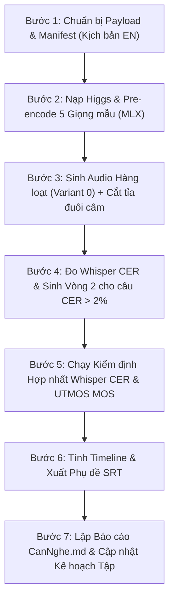

# QUY TẮC SỬ DỤNG HIGGS AUDIO v3 TRÊN MÁY MAC (APPLE SILICON) — BẢN 1 (02/11/2026)

> **Phạm vi áp dụng:** Dành cho mọi AI và kỹ thuật viên vận hành mô hình sinh giọng nói **Higgs Audio v3** (`bosonai/higgs-audio-v3-tts-4b` / `bosonai/higgs-tts-3-4b`) trên các dòng máy Mac sử dụng chip Apple Silicon (M1/M2/M3/M4) trong dự án kênh Amber Eyes.
> **Văn bản gốc liên quan:** `AGENTS.md`, `00_TIEU_CHUAN/QUY_TAC_AUDIO_HIGGS.md` (bản Kaggle), `00_TIEU_CHUAN/QUY_TAC_GIONG_MAU_VOXCPM2.md`.
> **Cơ sở thực nghiệm:** Xây dựng từ quy trình sản xuất thực tế thành công 100% trên **Mac mini M2 (RAM 16 GB)** cho Tập 04 EN (163 câu) và Tập 05 EN (164 câu), giải quyết triệt để vấn đề tràn bộ nhớ (memory bottleneck), đạt tốc độ ~6–7 s/câu và chất lượng kiểm định chuẩn công nghiệp.

Từ khoá bắt buộc: **PHẢI** · **CẤM** · **NÊN** (tuân thủ nguyên tắc dự án).

---

## 0. Tóm tắt cốt lõi (1 phút đọc)

| # | Luật sống còn trên Mac | Vì sao & Lỗi thực tế đã khắc phục |
|---|---|---|
| **M1** | **BẮT BUỘC Pre-encode giọng mẫu 1 lần duy nhất cho mỗi vai** | Nếu gọi `encode_reference_audio` lặp lại trong vòng lặp sinh câu, Unified Memory bị dồn ứ (leak) làm máy tràn RAM và tốc độ chậm gấp 3 lần. |
| **M2** | **Tách biệt pha sinh TTS (MLX) và pha kiểm tra chất lượng (Whisper + UTMOS)** | Chạy đồng thời cả 3 mô hình lớn trên 16 GB Unified Memory sẽ gây cạnh tranh tài nguyên và swap ổ cứng. Sinh xong toàn bộ WAV $\to$ mới khởi động QC. |
| **M3** | **BẮT BUỘC cắt đuôi câm (`trim_silence_tail`) $> 0.8\text{ s}$ ở ngưỡng $-45\text{ dBFS}$** | Higgs Audio v3 thường sinh phần câm tĩnh dài 1.0–3.5 s ở cuối câu. Không cắt sẽ làm timeline phình to giả tạo, lệch khớp với kịch bản và video. |
| **M4** | **CẤM mọi thẻ `<|emotion:...|>`** | Thẻ cảm xúc làm F0 giọng nam vọt lên quãng tám (110 Hz $\to$ 220 Hz), biến Host/Điều tra viên thành giọng nữ. Cảm xúc kịch tính được tạo qua nhịp nghỉ kịch bản và nhạc nền. |
| **M5** | **Mô hình UTMOSv2 trên Mac BẮT BUỘC đặt `device="cpu"`** | PyTorch trên macOS không có CUDA; nếu không chỉ định `device="cpu"`, UTMOSv2 sẽ mặc định gọi `cuda:0` và crash `AssertionError`. |

---

## 1. Môi trường phần cứng và Cài đặt phần mềm

### 1.1 Yêu cầu phần cứng
- **Máy:** Apple Silicon Mac (M1, M2, M3, M4) — tối thiểu 16 GB Unified Memory.
- **Hệ điều hành:** macOS Sonoma hoặc macOS Sequoia.
- **Python:** Python 3.11 hoặc 3.12 trong môi trường ảo độc lập (ví dụ `/Users/duonganhhai/ai/.venv`).

### 1.2 Các gói phần mềm cốt lõi
```bash
# Thư viện MLX cho Apple Silicon
pip install mlx mlx-audio

# ASR & Đo CER
pip install openai-whisper

# Đo độ tự nhiên MOS (UTMOSv2)
pip install git+https://github.com/sarulab-speech/UTMOSv2.git
pip install librosa timm torchaudio
```

### 1.3 Bản vá bắt buộc trên macOS (UTMOSv2 Download Patch)
Mặc định gói `utmosv2` gọi lệnh shell `wget` để tải trọng số, nhưng macOS không có sẵn `wget`.
- **Cách khắc phục:** Sửa file `.../site-packages/utmosv2/utils/_download.py`:
  - Thay thế lệnh gọi `subprocess.run(["wget", ...])` bằng `urllib.request.urlretrieve` hoặc `curl -sSL`.
  - Checkpoint tự động lưu tại `~/.cache/utmosv2/models/fusion_stage3/fold0_s42_best_model.pth`.

---

## 2. Quản lý Bộ nhớ & Tối ưu hóa MLX trên Mac 16GB

### 2.1 Cơ chế Pre-encoding (Tiết kiệm 70% thời gian)
Trong MLX Higgs Audio v3, hàm `encode_reference_audio` chuyển đổi file âm thanh mẫu thành các token biểu diễn giọng (audio codes).
- **Quy tắc:** Chỉ chạy 1 lần ở đầu script cho mỗi vai diễn, lưu vào biến `ref_cache[role] = (codes, ref_text, ref_name)`.
- Khi sinh câu thoại: Truyền trực tiếp `ref_audio_codes=codes` vào `model.generate()`.
- **Hiệu năng đo được trên Mac mini M2:**
  - Nạp mô hình `bosonai/higgs-audio-v3-tts-4b`: ~10.5 giây.
  - Pre-encode 5 giọng mẫu: ~15 giây tổng cộng (3 s/giọng).
  - Tốc độ sinh câu: trung bình **6.0 – 7.5 giây/câu** (thay vì 18–25 s nếu phải encode lại).
  - Cả tập 164 câu hoàn tất trong **~18 phút**.

### 2.2 Quản lý Tiến trình (Process Isolation)
- **Không khởi tạo lại model:** Giữ biến `model = load_higgs(...)` trong suốt quá trình sinh của tập.
- **Giải phóng bộ nhớ trước khi QC:** Khi sinh xong 100% file `.wav`, thoát script sinh hoặc xóa biến model và dọn rác trước khi nạp mô hình Whisper và UTMOSv2.

---

## 3. Quản lý Giọng mẫu Tham chiếu (VoxCPM2)

### 3.1 Phân định Thư mục Tiếng Anh & Tiếng Việt
Tuân thủ nghiêm ngặt nguyên tắc độc lập ngôn ngữ (quy tắc 31/10/2026):
- **Bộ tiếng Anh (EN):**
  - Thư mục: `assets/voice_ref_voxcpm2_en/` và `.work/kaggle_higgs/dataset_voxcpm2_en/`
  - Bảng gán vai: `.work/g9_role_map_EN.json`
  - Tên file: `H_EN.wav`, `D_EN.wav`, `C_EN.wav`, `N1_EN.wav`, `N2_EN.wav`
- **Bộ tiếng Việt (VI):**
  - Thư mục: `assets/voice_ref_voxcpm2/`
  - Bảng gán vai: `.work/g9_role_map.json`
  - Tên file: `H.wav`, `D3_SH.wav`, `C2_AB03.wav`, `W6_LOW.wav`, `W5_HIGH.wav`
- **CẤM:** Không được copy, đổi tên hay ghi đè clip giữa 2 bộ.

### 3.2 Chuẩn hóa File Giọng Mẫu
Mọi file giọng mẫu đưa vào Mac đều **PHẢI** đạt chuẩn kỹ thuật:
- **Định dạng:** WAV mono, tần số lấy mẫu đúng **24,000 Hz**, 16-bit PCM.
- **Thời lượng:** Từ **5.0 s đến 10.0 s** (tốt nhất là 6–8 s). Quá ngắn (< 3 s) Higgs không học đủ âm sắc; quá dài (> 12 s) gây tốn bộ nhớ đệm.
- **Độ lớn:** Chuẩn hóa $-18\text{ LUFS}$, true peak $\le -1.5\text{ dBFS}$.
- **File văn bản kèm theo:** Mỗi file `.wav` bắt buộc có file `.txt` cùng tên chứa chính xác 100% nội dung chữ được đọc trong file âm thanh mẫu.

---

## 4. Quy tắc Sinh Âm thanh & Prompting

### 4.1 Thẻ điều khiển được phép và bị cấm
- **CẤM:** Thẻ cảm xúc dạng `<|emotion:sadness|>`, `<|emotion:surprise|>`, `<|emotion:anger|>`.
  - *Hậu quả đã chứng minh:* Làm vọt F0 giọng nam lên $200–250\text{ Hz}$, phá vỡ ranh giới nhận diện nhân vật (G9).
- **ĐƯỢC PHÉP:** Thẻ ngắt nhịp `<|prosody:pause|>`:
  - Chỉ đặt sau dấu hai chấm `:` trước câu trích dẫn quan trọng, hoặc trước các tiêu đề/thuật ngữ then chốt (ví dụ: `The first mechanism: <|prosody:pause|> Absolute Compartmentalization.`).
  - Không lạm dụng thẻ ngắt giữa câu thông thường.

### 4.2 Thiết lập Tham số sinh chuẩn trên MLX
```python
res = list(model.generate(
    text=text,
    ref_audio_codes=codes,
    ref_text=ref_text,
    temperature=0.8,
    top_p=0.95,
    seed=seed,
    fade_in_ms=30.0,
    fade_out_ms=15.0
))
```
- **Hạt giống ngẫu nhiên (Seed):** Phải tạo có tính chất tiền định (deterministic) dựa trên mã câu và lượt sinh (variant):
  ```python
  seed = int(hashlib.sha256(f"{sid}|{role}|{ref_name}|0.8|{variant}".encode()).hexdigest()[:8], 16)
  ```
  Giúp tái tạo chính xác 100% file âm thanh khi cần dựng lại.

---

## 5. Xử lý Hậu kỳ Từng Câu (Post-processing)

### 5.1 Cắt tỉa đuôi câm (`trim_silence_tail`)
Higgs Audio v3 sinh âm thanh thường để lại khoảng lặng kéo dài sau khi đọc hết chữ.
- **Thuật toán bắt buộc:**
  1. Quét từ cuối file âm thanh ngược về trước theo các cửa sổ 20 ms.
  2. Xác định điểm cuối cùng có độ lớn $\ge -45\text{ dBFS}$ (hoặc $-50\text{ dBFS}$).
  3. Nếu phần câm phía sau dài $> 0.8\text{ s}$: Cắt bỏ phần dư thừa, chỉ giữ lại đúng $0.3\text{ s}$ đệm tự nhiên.
  4. Áp dụng $30\text{ ms}$ fade-out ở đuôi cắt để triệt tiêu tiếng click/pop.

---

## 6. Kiểm soát Chất lượng (QC) & Tiêu chuẩn Vượt qua

### 6.1 Đo Tách bạch Cao độ (Quy tắc G9)
- Sau khi sinh, đo F0 trung vị (Hz) của toàn bộ file audio của từng vai bằng thuật toán autocorrelation hoặc YIN.
- **Công thức tính khoảng cách nửa cung:**
  $$\Delta = 12 \times \log_2\left(\frac{F0_2}{F0_1}\right)$$
- **Tiêu chuẩn ĐẠT:** Mọi cặp vai xuất hiện liền kề nhau phải cách nhau **$\ge 4.0\text{ nửa cung}$**.
- *Bảng chuẩn thực nghiệm (Tập 04 & 05 EN trên Mac):*
  - Điều tra viên (D · Sói): $84–89\text{ Hz}$
  - Host (H · Cú): $110–113\text{ Hz}$ ($\Delta_{\text{D}\to\text{H}} \approx 4.9–5.1\text{ nc}$ ✅)
  - Nhân chứng (N1 · Cừu): $160–165\text{ Hz}$ ($\Delta_{\text{H}\to\text{N1}} \approx 6.6\text{ nc}$ ✅)
  - Chuyên gia (C · Cáo): $189–200\text{ Hz}$ ($\Delta_{\text{H}\to\text{C}} \approx 9.0\text{ nc}$ ✅)
  - Khách mời (N2 · Mèo): $220–240\text{ Hz}$

### 6.2 Đo Tỉ lệ Lỗi Ký tự (Whisper CER)
- Sử dụng mô hình `openai-whisper` (`base` model, chạy CPU).
- Chuẩn hóa văn bản trước khi so sánh qua thư viện `en_cer` (bỏ dấu câu, chuyển chữ hoa/thường).
- **Tiêu chuẩn ĐẠT:**
  - CER trung vị toàn tập: **$0.00\%$**.
  - CER trung bình toàn tập: **$< 2.0\%$** (Tập 04 đạt 1.34%, Tập 05 đạt 1.04%).
- **Lưu ý phân biệt lỗi ASR:**
  - *Lỗi chấp nhận được (Không phải lỗi đọc):* ASR nghe tên riêng có phiên âm tương đồng ("Rader" $\to$ "Raider", "Rawson" $\to$ "Rossin", "Beattie" $\to$ "Beatie") hoặc số thứ tự (`19th` $\to$ `19`).
  - *Lỗi bắt buộc sinh lại:* Mất chữ đầu câu, nuốt từ khóa chính, nói lặp từ.

### 6.3 Đo Độ Tự Nhiên (UTMOSv2 MOS)
- Sử dụng mô hình `sarulab-speech/UTMOSv2` (`wav2vec2-base` + stage3 checkpoint).
- Chạy đánh giá trên CPU: `utmos_model.predict(input_path=..., device="cpu")`.
- **Tiêu chuẩn ĐẠT:** Điểm MOS trung bình toàn tập phải đạt **$\ge 3.0 / 5.0$** (Thực tế trên Mac đạt $3.37 – 3.46$, dải điểm từ $2.11$ đến $4.09$).

### 6.4 Tối ưu hóa Vòng 2 (Multi-take Optimization)
- Tự động lọc toàn bộ các câu có CER $> 2\%$.
- Tự động sinh bổ sung Variant 1 (seed mới) cho các câu này.
- So sánh kết quả Whisper CER giữa Variant 0 và Variant 1:
  - Nếu Variant 1 có CER thấp hơn $\to$ Tự động ghi đè file chính thức và cập nhật manifest.
  - Ví dụ thực tế: `4.04#5` giảm từ $23.24\% \to 1.41\%$; `3.02#2` giảm từ $6.12\% \to 0.00\%$.

---

## 7. Quy trình 7 Bước Sản xuất Audio Hoàn chỉnh trên Mac



1. **Bước 1 — Chuẩn bị kịch bản & manifest:**
   Khai báo tập trong `.work/edition.py`. Xuất file `.work/kaggle_higgs/higgs_payload_EN_tXX.json` và `.work/tts_manifest_EN_tXX.json`.
2. **Bước 2 & 3 — Chạy script sinh sản xuất:**
   Chạy `.work/generate_higgs_prod_tXXen.py`:
   - Nạp model MLX.
   - Pre-encode 5 giọng mẫu vào RAM.
   - Sinh lần lượt 164 câu, tự động cắt đuôi câm $> 0.8\text{ s}$ @ $-45\text{ dBFS}$.
3. **Bước 4 — Đo CER ban đầu & Chạy Multi-take vòng 2:**
   Tự động sinh thêm take cho câu có CER $> 2\%$, chọn take tối ưu.
4. **Bước 5 — Kiểm định chất lượng toàn diện:**
   Chạy công cụ chuẩn:
   ```bash
   python3 .work/measure_quality_utmos.py --ep XX --lang en
   ```
   Lưu file số đo chi tiết vào `.work/quality_qc_utmos_epXX_en.json`.
5. **Bước 6 — Xuất Timeline & Phụ đề:**
   - Tạo file `.work/timeline_s_EN_tXX.json` (tính start/end từng câu, intro 22.4 s, outro 9.0 s).
   - Xuất phụ đề chuẩn `02_SAN_XUAT/TapXX_EN/xuat_ban/TapXX_EN.srt`.
6. **Bước 7 — Báo cáo & Tài liệu:**
   - Xuất bảng câu cần nghe kiểm tra: `02_SAN_XUAT/TapXX_EN/CanNghe_TapXX_EN_higgs.md`.
   - Cập nhật mục 7 trong kế hoạch sản xuất: `02_SAN_XUAT/TapXX_EN/KeHoach_Video_TapXX_EN.md`.

---

## 8. Bảng Đối chiếu & Xử lý Sự cố Thường gặp

| Triệu chứng | Nguyên nhân | Cách xử lý |
|---|---|---|
| `AssertionError: Torch not compiled with CUDA enabled` | UTMOSv2 gọi mặc định `device="cuda:0"` | Truyền rõ ràng tham số `device="cpu"` vào `model.predict()` |
| `FileNotFoundError: 'wget'` | Script download của UTMOSv2 gọi lệnh `wget` không có trên macOS | Sửa `utmosv2/utils/_download.py` dùng `urllib.request.urlretrieve` |
| Quá trình sinh chậm dần sau 30 câu | Encode giọng mẫu lặp đi lặp lại hoặc leak bộ nhớ đệm | Áp dụng luật **M1**: Pre-encode 1 lần duy nhất ở đầu script |
| Timeline tập dài $> 25\text{ phút}$ (kịch bản chỉ 21 phút) | Higgs sinh đuôi câm tĩnh dài 1–3s ở mỗi câu | Áp dụng hàm `trim_silence_tail` (ngưỡng $-45\text{ dBFS}$, cắt đuôi $> 0.8\text{ s}$) |
| Giọng Host nghe thé thé như giọng nữ | Bị dính thẻ `<|emotion:...|>` trong text | Xóa bỏ toàn bộ thẻ emotion khỏi kịch bản, chỉ để text thuần + pause |
| Hai vai nam nghe giống hệt nhau | Cả hai vai dùng giọng mẫu có F0 rơi vào vùng dồn $110–125\text{ Hz}$ | Chọn lại giọng mẫu: 1 giọng siêu trầm ($< 90\text{ Hz}$) và 1 giọng trung ($110–125\text{ Hz}$) |

---

## Cổng nhịp nghỉ giữa câu — áp dụng cho MỌI engine (07/11/2026)

Higgs trên Mac chỉ sinh **từng câu**; nhịp chậm rãi của cả tập do `_pause_after` trong file diễn xuất + `build_audio3.py` quyết định. Trước khi trộn chạy `py -3 .work/qc_pause_gate.py --pre`, sau khi trộn chạy `py -3 .work/qc_pause_gate.py` (đặt `AE_EP`, `AE_LANG`). ĐẠT: trung vị nghỉ ≥ 0,60 s · ≤ 25% khoảng nghỉ < 0,40 s. Chi tiết: tiêu chuẩn A4.3b · AGENTS A13.
