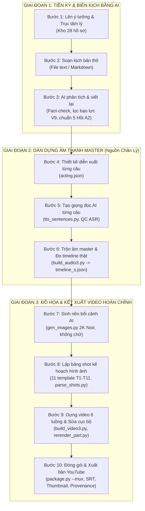

# QUY TRÌNH SẢN XUẤT VIDEO TỪ ĐẦU ĐẾN CUỐI BẰNG AI
**Dự án:** AMBER EYES — Phân tích tâm lý học tội phạm qua hồ sơ có thật  
**Phiên bản:** 10 / 11 · Cập nhật chuẩn hóa tháng 10/2026  
**Thư mục lưu trữ chuẩn:** `00_TIEU_CHUAN/QUY_TRINH_SAN_XUAT_VIDEO_AI.md`

---

## I. TỔNG QUAN KIẾN TRÚC QUY TRÌNH

Quy trình sản xuất của kênh kết hợp giữa **Sáng tạo nội dung có AI trợ lực (AI-Assisted Writing)** và **Hệ thống dựng tự động hóa (Automated Video Pipeline)**:



---

## II. CHÍN QUY TẮC VÀNG BẮT BUỘC (V1 – V9)

| Mã | Tên quy tắc | Ý nghĩa & Thực thi |
|:---:|---|---|
| **V1** | **Đơn vị đồng bộ là CÂU** | TTS đọc từng câu thành 1 file MP3 riêng; mọi mốc thời gian đo đạc chính xác bằng `ffprobe`. Cấm chia frame theo tỉ lệ ước tính. |
| **V2** | **Hình chỉ đổi ở đầu câu** | Cấm chuyển cảnh hoặc nhảy shot giữa chừng khi câu đang đọc dang dở. |
| **V3** | **Chữ lấy nguyên văn từ câu** | Không tự ý thêm số liệu, bịa đặt dữ kiện; câu trích dẫn phải giữ nguyên văn (dùng `…` để lược, không tự thêm dấu hỏi). |
| **V4** | **Không im lặng quá 0,3 giây** | Luôn có lớp nền trầm (`bgm_ambient_deep`) chạy liên tục ở mức −34 dB xuyên suốt toàn tập. |
| **V5** | **Người thật chỉ hiện dạng bóng** | Khuôn mặt người thật, nạn nhân, can phạm luôn chìm hoàn toàn trong bóng tối; bác sĩ, quan chức thật không vẽ mà chỉ hiện chữ thông tin. |
| **V6** | **Linh thú là nhân vật minh hoạ** | Giữ nhãn *"Nhân vật minh hoạ · giọng đọc AI"* ở lần xuất hiện đầu; diện tích chiếm $\le 20\%$ khung hình tại góc. |
| **V7** | **Nền vụ án toàn màn hình (16:9)** | Bối cảnh vụ án làm canvas bao quát toàn bộ video 100% thời lượng. |
| **V8** | **Chuẩn nhận diện & Nguồn gốc** | Mọi tập mở đầu bằng Intro kênh 22,41s; 100% tài sản phải ghi vào `provenance.json`. |
| **V9** | **Trọng tâm phân tích tâm lý** | Tuyệt đối không mô tả chi tiết vết thương, thi thể, máu me; tập trung vào cơ chế tâm lý và pháp y khách quan để bảo vệ kênh và tối ưu quảng cáo YouTube. |

---

## III. CHI TIẾT 10 BƯỚC THỰC HIỆN TỪ ĐẦU ĐẾN CUỐI

### GIAI ĐOẠN 1: TIỀN KỲ & BIÊN KỊCH BẰNG AI

#### Bước 1: Lên ý tưởng & Xác định trục tâm lý cốt lõi
*   **Hồ sơ ý tưởng:** Lựa chọn từ kho dữ liệu `01_KICH_BAN/KHO_Y_TUONG_28_HO_SO.md`.
*   **Xác định trục tâm lý học:** Chọn hội chứng làm trục xương sống cho tập (ví dụ: Hội chứng Münchausen qua trung gian FDIA, Thái nhân cách Psychopathy, Quy luật leo thang hành vi, Trauma Bonding...).
*   **Xác định The Hook:** Nghịch lý mở đầu gây tò mò tột độ để giữ chân khán giả trong 60 giây đầu tiên.

#### Bước 2: Tạo kịch bản thô (File Text)
*   Soạn bản thảo dưới dạng văn bản thô `.txt` hoặc `.md` (như `Kc_1.txt`, `Kich_ban.txt`, hoặc `kichban_tapXX_ban_goc.md`).
*   Gom đầy đủ: diễn biến vụ án, mốc thời gian, trích dẫn báo chí, biên bản điều tra, không cần format kỹ thuật.

#### Bước 3: AI phân tích, đối chiếu sự thật và viết lại kịch bản
Đưa file text thô cho AI thực hiện 4 nhiệm vụ chuẩn hóa:
1.  **Cấu trúc 5 Hồi chuẩn:**
    *   *Hồi 1 (The Hook):* Khoảnh khắc đứt gãy niềm tin – Đặt ra nghịch lý lớn nhất vụ án.
    *   *Hồi 2 (Hiện trường & Hồ sơ):* Bóc tách các chứng cứ y khoa/điều tra thực tế.
    *   *Hồi 3 (Giải phẫu tâm lý):* Phân tích sâu các tầng động cơ vô thức và ý thức.
    *   *Hồi 4 (Góc nhìn nạn nhân / Thẩm vấn):* Cơ chế tâm lý nạn nhân hoặc cuộc đấu trí phòng hỏi cung.
    *   *Hồi 5 (Phán quyết & Lời kết):* Bản án pháp lý, 4 dấu hiệu cảnh báo đỏ (*Red Flags*) và thông điệp nhân văn.
2.  **Đối chiếu nguồn sự thật (Fact-Checking):** Tra cứu Wikipedia, hồ sơ tòa án, báo chí chính thống để sửa các dữ kiện sai lệch, tên đường, chức danh, đại từ xưng hô (như file mẫu `REVIEW_kichban_tap02.md`).
3.  **Lọc bạo lực theo Quy tắc V9:** Loại bỏ từ ngữ bạo lực trực diện, chuyển dịch sang góc nhìn phân tích chuyên môn.
4.  **Viết lại kịch bản chuẩn A2 (`kichban_tapXX.md`):**
    *   Phân chia lời thoại đúng 4-5 vai dẫn chuyện: `HOST` (Cú), `ĐIỀU TRA VIÊN` (Sói), `CHUYÊN GIA TÂM LÝ` (Cáo), `NGƯỜI BÌNH THƯỜNG` (Cừu / Mèo).
    *   Gắn chỉ dẫn cảm xúc: `*(chỉ dẫn)*`.
    *   Gắn mốc kỹ thuật: `**[SFX]:** ...`, `**[BGM]:** ...`, `**[Nghỉ X giây]**`.

---

### GIAI ĐOẠN 2: SẢN XUẤT ÂM THANH AI (Nguồn Chân Lý)

#### Bước 4: Tách câu & Thiết kế diễn xuất từng câu (`acting.json`)
*   Chạy script tách câu:
    ```powershell
    py -3 .work/parse_kichban.py 01_KICH_BAN/TapXX/kichban_tapXX.md .work/script_tapXX.json
    ```
*   AI lập file diễn xuất `make_acting_tapXX.py` $\to$ `.work/acting_tapXX.json`:
    *   Cảm xúc: `neutral`, `sad`, `fearful`, `surprised`, `happy`.
    *   Độ lệch tốc độ: Giảm từ −0,06 đến +0,02 để nhịp đọc tự nhiên, không vội.
    *   Cao độ an toàn: −4 đến +3 nửa cung (tránh làm méo thanh điệu tiếng Việt).
    *   **Khoảng lặng kịch tính (`_pause_after`):** Đặt từ 0,2 đến 1,2 giây **GIỮA các câu** sau những chi tiết hé lộ hoặc câu chốt hạ. **Tuyệt đối không chèn `<#s#>` hay `...` ở giữa câu tiếng Việt.**

#### Bước 5: Đọc giọng AI từng câu (TTS)
*   Thực thi lệnh đọc:
    ```powershell
    $env:AE_EP="XX"; py -3 .work/tts_sentences.py
    ```
*   Chạy kiểm thử [qc_asr.py](file:///d:/TEST/Gax/Audi/.work/qc_asr.py) để mô hình nhận dạng nghe lại, bảo đảm 0% lỗi chữ (CER = 0%) và không bị đọc nhầm thẻ kỹ thuật.

#### Bước 6: Trộn âm master Stereo 3 lớp & Xuất mốc thời gian thực
*   Thực thi lệnh trộn âm:
    ```powershell
    $env:AE_EP="XX"; py -3 .work/build_audio3.py
    ```
*   **Cấu trúc hòa âm 3 lớp:**
    1.  *Lớp Lời:* Nối các câu thoại kèm khoảng nghỉ và `_pause_after`.
    2.  *Lớp Nền môi trường (Ambience Bed):* Chạy âm thanh stereo không gian phòng kín, gió tuyết, đèn huỳnh quang ở −27 đến −38 dB dưới lời.
    3.  *Lớp BGM & Tiếng động SFX:* Nhạc đổi theo từng hồi (tự hạ âm lượng khi có lời); tiếng động thực tế lấy từ YouTube Audio Library kết hợp tiếng động code.
*   Chuẩn hóa âm lượng: 2 lượt `loudnorm` đạt chuẩn truyền hình $-16\text{ LUFS}$ (True Peak $-1.5\text{ dBTP}$).
*   **Đo đạc thời gian:** Dùng `ffprobe` đo đạc chính xác tuyệt đối trên master $\to$ xuất ra `timeline_s.json`.

---

### GIAI ĐOẠN 3: ĐỒ HỌA & KẾT XUẤT VIDEO BẰNG AI

#### Bước 7: Sinh bối cảnh AI (AI Backgrounds)
*   Thực thi tạo ảnh 2K 16:9 ($2112 \times 1188$ px):
    ```powershell
    py -3 .work/gen_images.py .work/bg_jobs_tapXX.json
    ```
*   Negative Prompt bắt buộc: `no text, no letters, no numbers, no signs, no logos, no watermark, no border`. Nhân vật người thật chỉ là `silhouette, face completely hidden in deep shadow`.
*   Hậu kỳ xén viền đen và inpaint xóa chữ bằng `fix_backgrounds.py`.

#### Bước 8: Lập bảng shot kế hoạch hình ảnh
*   Viết bảng shot vào Mục 6 của hồ sơ tập `02_SAN_XUAT/TapXX/KeHoach_Video_TapXX.md`.
*   Ánh xạ từng câu thoại vào **11 mẫu Template Graphic Novel Noir (T1 – T11)**:
    *   *T1 (Toàn cảnh):* Nền u ám, lớp tối đáy, chữ góc dưới.
    *   *T2 (Thẻ hồ sơ):* Giấy xoay −1,5°, dấu mộc đỏ sát chữ cuối.
    *   *T3 (So sánh / Chia đôi):* Vạch màu vai, so sánh đối lập 2 luận điểm.
    *   *T4 (Trích dẫn):* Nền tối 70%, ngoặc kép màu vai, font Cambria Italic.
    *   *T5 (Con số / Ngày gõ):* Số đếm chạy 1,2s hoặc máy chữ gõ ngày tháng.
    *   *T6 (Dòng thời gian):* Trục ngang, mốc phát sáng so le theo câu.
    *   *T7 (Tuyến đường):* Ghim bản đồ, đường đứt nét tự vẽ trong 1,5s.
    *   *T8 (Danh sách):* Gạch bỏ (loại trừ) hoặc Cờ đỏ (Red Flags tô dần).
    *   *T9 (Thuật ngữ):* Thẻ giải nghĩa từ vựng tâm lý học DSM-5.
    *   *T10 (Thẻ chương):* Nền `void` tối, tiêu đề hồi to giữa màn hình.
    *   *T11 (Bài đăng MXH):* Khung mạng xã hội mờ, có tem MINH HỌA.
*   Chạy kiểm tra chữ và font:
    ```powershell
    $env:AE_EP="XX"; py -3 .work/parse_shots.py
    ```

#### Bước 9: Dựng hình tự động đa luồng & Sửa cục bộ
*   **Xuất ảnh tĩnh duyệt trước (0,4s/ảnh):**
    ```powershell
    $env:AE_EP="XX"; py -3 .work/build_video3.py --stills 15,45,80
    ```
*   **Render video hoàn chỉnh:**
    ```powershell
    $env:AE_EP="XX"; py -3 .work/build_video3.py --workers 6
    ```
    Hệ thống chia video làm 6 tiến trình song song, áp dụng chuyển động camera (`push`, `pull`, `pan`, `hero`), hạt phim film grain, badge người nói, linh thú bán thân nhấp nháy thở và chữ vector.
*   **Sửa cục bộ nếu có lỗi:**
    $$\text{phần } K = (\text{thời\_điểm\_giây} \times 30) // \lceil\text{tổng\_khung} / 6\rceil$$
    Chạy `rerender_part.py K` để sửa riêng phần đó trong 3–4 phút.

#### Bước 10: Đóng gói thành phẩm & Xuất bản YouTube
*   Thực thi lệnh đóng gói:
    ```powershell
    $env:AE_EP="XX"; py -3 .work/subtitles.py
    $env:AE_EP="XX"; py -3 .work/package.py --mux
    ```
*   **Đầu ra tại `02_SAN_XUAT/TapXX/xuat_ban/`:**
    *   `TapXX_master.mp4`: Video hoàn chỉnh 1080p@30fps.
    *   `TapXX_master.mp3`: File âm thanh podcast master.
    *   `TapXX.srt`: Phụ đề khớp từng mili-giây.
    *   `thumbnail.png`: Ảnh thu nhỏ YouTube chuẩn Noir.
    *   `mo_ta.txt`: Mô tả có mốc chương Timestamp và cảnh báo hỗ trợ trẻ em (Tổng đài 111).
    *   `provenance.json`: Sổ nguồn gốc tài sản chứng minh bản quyền thương mại.

---

## IV. BẢNG MÃ NHẬN DIỆN 5 LINH THÚ DẪN CHUYỆN

| Nhân vật | Linh thú | Màu Rim Light / Hex | Font đặc trưng | Tính cách & Vai trò |
|---|---|---|---|---|
| **HOST (H)** | Cú mèo Tri thức | Hổ phách (`#E2B467`) | Cambria / Segoe UI | Điềm tĩnh, kết nối, nhìn thấu trong đêm tối. |
| **ĐIỀU TRA VIÊN (D)** | Sói xám Truy vết | Xanh thép lạnh (`#86A9CC`) | Consolas | Sắc lạnh, bám sát chứng cứ, hiện trường, hồ sơ. |
| **CHUYÊN GIA (C)** | Cáo thông thái | Tím suy tưởng (`#A99BD6`) | Segoe UI / Cambria | Trực giác tâm lý sắc sảo, giải mã cơ chế vô thức. |
| **HÀNG XÓM (N1)** | Cừu non lương thiện | Nâu cát ấm (`#D9B99B`) | Cambria Italic | Ngây thơ, xúc động, đại diện nhân chứng bị lừa dối. |
| **KHÁN GIẢ (N2)** | Mèo con tò mò | Xanh lơ digital (`#6E8CA0`) | Segoe UI Semibold | Hoài nghi, đặt câu hỏi, phản ứng của dư luận mạng. |

---

## V. CHECKLIST NHANH KHI BẮT ĐẦU TẬP MỚI

Khi bắt đầu làm một tập mới (ví dụ: Tập 03):

1. Soạn kịch bản thô $\to$ nhờ AI phân tích, đối chiếu sự thật, lọc bạo lực V9 và xuất file `01_KICH_BAN/Tap03/kichban_tap03_22102026.md`.
2. Khai báo tập mới trong `edition.py` (tên tập, bài nhạc, nhân vật N1/N2).
3. Sao chép `KeHoach_Video_Tap01.md` thành `02_SAN_XUAT/Tap03/KeHoach_Video_Tap03.md`, lập danh sách nền và viết bảng shot ở Mục 6.
4. Chạy chuỗi lệnh tự động:
   ```powershell
   $env:PYTHONIOENCODING="utf-8"; $env:AE_EP="03"
   py -3 .work/parse_kichban.py 01_KICH_BAN/Tap03/kichban_tap03_22102026.md .work/script_tap03.json
   py -3 .work/make_acting_tap03.py
   py -3 .work/tts_sentences.py
   py -3 .work/build_audio3.py
   py -3 .work/parse_shots.py
   py -3 .work/gen_images.py .work/bg_jobs_tap03.json
   py -3 .work/build_video3.py --stills 20,60,100
   py -3 .work/build_video3.py --workers 6
   py -3 .work/subtitles.py
   py -3 .work/package.py --mux
   ```
Toàn bộ video hoàn chỉnh, phụ đề và mô tả sẵn sàng đăng sẽ nằm tại [02_SAN_XUAT/Tap03/xuat_ban/](file:///d:/TEST/Gax/Audi/02_SAN_XUAT).
