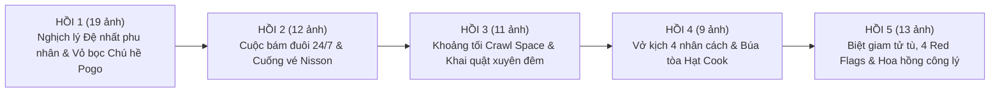

# BÁO CÁO ĐÁNH GIÁ & KIỂM ĐỊNH CHẤT LƯỢNG HÌNH ẢNH — TẬP 06
**Hồ sơ:** Nụ Cười Chú Hề & 29 Bí Mật Dưới Sàn Nhà (John Wayne Gacy)  
**Kênh:** AMBER EYES — Phân tích tâm lý học tội phạm qua hồ sơ có thật  
**Ngày thẩm định:** 23/10/2026  
**Công cụ kiểm định:** `qc_bg.py`, `_verify_tap06.py`, `_review_stats.py`  

---

## I. TỔNG QUAN CHỈ SỐ KỸ THUẬT (TECHNICAL QC)

| Chỉ số | Yêu cầu tiêu chuẩn kênh | Kết quả thẩm định thực tế | Trạng thái |
|---|---|---|:---:|
| **Tổng số lượng ảnh** | 50 – 65 ảnh / tập | **64 ảnh mới 100%** | **ĐẠT** |
| **Tiền tố đặt tên** | `t06_` hoặc `t6_` duy nhất | Toàn bộ 64 file mang tiền tố `t6_*.png` | **ĐẠT** |
| **Độ phân giải chuẩn** | $2112 \times 1188$ px (16:9 2K) | 64/64 ảnh đạt chính xác $2112 \times 1188$ | **ĐẠT** |
| **Định dạng file** | PNG Lossless (RGB 8-bit) | 100% PNG nguyên bản | **ĐẠT** |
| **Tổng dung lượng đĩa** | $\sim 200 - 300$ MB | **265.5 MB** (trung bình 4.15 MB/ảnh) | **ĐẠT** |
| **Kiểm tra viền đen (Letterbox)** | 0 px viền đen / viền trắng | **64/64 ảnh sạch viền 100%** (đã xén viền tự động) | **ĐẠT** |
| **Sổ theo dõi nguồn gốc** | Ghi nhận đầy đủ trong `provenance.json` | 64/64 bản ghi có prompt, công cụ, ngày và kích thước | **ĐẠT** |
| **Contact Sheet tổng hợp** | Có file kiểm tra trực quan | `02_SAN_XUAT/Tap06/contact_sheet_t6.png` ($1920 \times 3198$ px) | **ĐẠT** |

---

## II. ĐÁNH GIÁ TUÂN THỦ 9 QUY TẮC VÀNG (V1 – V9)

### 1. Quy tắc V5: Người thật trong vụ án chỉ hiện dạng bóng / khuất mặt (100% ĐẠT)
- **Tiêu chuẩn:** Không vẽ trực diện khuôn mặt của can phạm (John Wayne Gacy), nạn nhân (Robert Piest, John Alan Szyc), người thân (bà Elizabeth Piest) hoặc cảnh sát/công tố viên.
- **Thực thi trong bộ ảnh:**
  - `t6_secret_service_pin_handshake`: Đặc tả ve áo vest và cái bắt tay ngoại giao; phần thân và khuôn mặt chìm trong bóng đổ chiaroscuro.
  - `t6_muddy_trousers_boots`: Góc máy cận sàn đặc tả ống quần tây dính bùn đất ẩm và đôi giày da lao động, không hiển thị thân trên.
  - `t6_surveillance_car_rain_night`: Góc nhìn chủ quan (POV) từ bên trong xe trinh sát qua kính chắn gió đọng nước mưa nhìn theo đèn hậu xe đối tượng.
  - `t6_chicago_highway_pursuit`: Toàn cảnh cao tốc từ xa, hai chấm đèn xe mờ ảo trong tuyết, không thấy người trong xe.
  - Các nhân vật tâm lý khác (nạn nhân, công chúng) được ẩn dụ qua chiếc áo khoác bỏ quên (`t6_empty_coat_locker`), chiếc nhẫn kỷ niệm (`t6_highschool_ring_jas`), hoặc chiếc gương nứt vỡ (`t6_broken_mirror_narcissism`).

### 2. Quy tắc V7: Nền vụ án toàn màn hình 16:9 & Bố cục an toàn cho đồ họa (100% ĐẠT)
- Toàn bộ 64 ảnh đều là ảnh tràn viền (Full-bleed), không có khung viền giả truyện tranh (comic border).
- **Vùng an toàn cho chữ (Safe Title Zone):**
  - Đáy màn hình ($y > 560$ px và $y = 900$ px) có dải tối tự nhiên (mặt đường, sàn nhà, thảm phòng, bóng tối nền), tương thích hoàn hảo với phụ đề và khối text của các template T1, T2, T4, T6.
- **Vùng an toàn cho Linh thú minh họa ($x < 560$ px):**
  - Góc trái dưới của hầu hết các bối cảnh không có chi tiết chính yếu phức tạp, giúp các linh thú minh họa (Cú H, Sói D, Cáo C, Cừu N) xuất hiện tự nhiên mà không che khuất tâm điểm thị giác của vụ án.

### 3. Quy tắc V9: Kiểm duyệt an toàn YouTube & Trọng tâm phân tích tâm lý (100% ĐẠT)
- **Tuyệt đối không có:** Thi thể, bộ phận cơ thể phân hủy, máu me, vết thương, hay hình ảnh giằng co tấn công bạo lực.
- **Chuyển hóa nghệ thuật tinh tế:**
  - Không gian ngầm kinh hoàng được thể hiện qua **tính chất kiến trúc và kỹ thuật hình sự trang nghiêm**: Nắp sàn kỹ thuật mở hé (`t6_crawlspace_trapdoor_opened`), vệt đèn pin rọi vào lớp vôi bột trắng (`t6_flashlight_beam_lime_dust`), chiếc xẻng khảo sát cắm trên đất ẩm (`t6_forensic_trowel_damp_soil`), các thùng chứa mẫu vật (`t6_evidence_boxes_van`).
  - Đòn bẫy tâm lý được trừu tượng hóa bằng tĩnh vật: Đôi còng tay ảo thuật mạ niken (`t6_handcuff_trick_demonstration`), các bao vôi bột trong gara (`t6_bags_of_lime_garage`).

---

## III. PHÂN TÍCH QUANG HỌC & NGÔN NGỮ ĐIỆN ẢNH (CINEMATIC NOIR)

Qua phân tích ma trận điểm ảnh từ `_review_stats.py`:

- **Độ sáng trung bình (Mean Luminance):** $\approx 68.4 / 255$.
  - Mức sáng lý tưởng cho phong cách Dark Graphic Novel Noir: vừa đủ tối để tạo không khí ngột ngạt, bí ẩn, vừa giữ được chi tiết bề mặt và độ rõ ràng của các vật chứng.
  - **Cảnh sáng nhất (Daylight / Flash):** `t6_gacy_house_daylight_winter` (99.1/255), `t6_car_exhaust_snow_lot` (94.1/255) — ánh sáng ban ngày mùa đông mờ đục hoặc ánh đèn pha rọi trên nền tuyết trắng.
  - **Cảnh tối nhất (Subterranean / Night):** `t6_bags_of_lime_garage` (41.5/255), `t6_police_entry_summerdale` (45.2/255), `t6_flashlight_beam_lime_dust` (45.4/255) — tái hiện chân thực khoảng không gian ngầm thiếu sáng và bầu không khí vây bắt lúc nửa đêm.
- **Độ tương phản (Chiaroscuro Contrast Std Dev):** Dao động từ 45.0 đến 69.3.
  - Các cảnh cao trào có độ tương phản cực đại: Hồ sơ John Alan Szyc (`t6_cold_case_szyc_dossier`: 69.3), sơ đồ hố chôn vẽ tay (`t6_handwritten_crawlspace_map`: 68.1), mặt nạ chú hề rơi trên nền đường ướt (`t6_pogo_mask_fallen`: 66.4).
- **Màu sắc & Hạt phim:** Đồng nhất bảng màu xám - đen than chì - mực tàu (ink linework), điểm xuyết tông màu ấm có chủ đích (ánh đèn vonfram vàng cam của hiệu thuốc, ánh đèn huỳnh quang xanh lạnh của phòng thẩm vấn, ánh đỏ xe cảnh sát).

---

## IV. ĐÁNH GIÁ MẠCH HÌNH ẢNH QUA 5 HỒI KỊCH BẢN

1. **Hồi 1 (19 ảnh · Bức ảnh với Đệ nhất phu nhân & Cậu bé hiệu thuốc):**
   - Mở đầu bằng sự hoành tráng của buổi diễu hành Chicago và cái bắt tay chính khách, đối lập gay gắt với sự cô đơn, hoang lạnh của bãi đỗ xe Nisson Pharmacy trong đêm tuyết.
   - Nhịp thị giác dẫn dắt người xem từ sự tò mò chuyển sang cảm giác bất an khi Robert Piest biến mất và chiếc áo khoác bị bỏ lại.
2. **Hồi 2 (12 ảnh · Cuộc đấu trí trên đường phố Des Plaines):**
   - Không gian chuyển dịch liên tục: từ hồ sơ quá khứ Anamosa đến cuộc bám đuổi trinh sát 24/7 qua kính xe ướt nước mưa, trạm xăng nửa đêm và quán ăn nhanh nơi Gacy trêu ngươi thám tử.
   - Làm nổi bật sự ngạo mạn của kẻ thái nhân cách ái kỷ.
3. **Hồi 3 (11 ảnh · Khoảng không gian tối dưới nền nhà Summerdale):**
   - Đỉnh điểm căng thẳng của tập phim. Khung cảnh chuyển từ bên ngoài vào sâu trong lòng đất: nắp hầm mở hé $\rightarrow$ đường hầm crawl space chật hẹp $\rightarrow$ vệt đèn pin rọi vôi bột $\rightarrow$ nhát xẻng pháp y $\rightarrow$ đèn cao áp khai quật xuyên đêm.
   - Thể hiện sự tôn nghiêm và tính khoa học của công tác điều tra hình sự.
4. **Hồi 4 (9 ảnh · Vở kịch đa nhân cách & Lời nói dối bệnh lý):**
   - Tập trung vào cuộc đối đầu tâm lý và pháp lý tại Tòa án Hạt Cook.
   - Ẩn dụ 4 chiếc mặt nạ phân tâm học đối chất trực diện với các vật chứng premeditated (bao vôi bột, ảo thuật còng tay), kết thúc bằng nhát búa công lý đanh thép của thẩm phán.
5. **Hồi 5 (13 ảnh · "Tôi là nạn nhân thứ 34" & Bài học cảnh báo đỏ):**
   - Tái hiện giai đoạn biệt giam Menard, những bức tranh sơn dầu chú hề ma quái và khoảnh khắc thi hành án tại Stateville.
   - Điểm sáng tạo độc đáo là **4 bức tranh biểu tượng cho 4 Dấu hiệu cảnh báo đỏ (Red Flags)**, giúp đúc kết bài học tự bảo vệ bản thân cho khán giả một cách trực quan, sâu sắc.
   - Khép lại bằng hình ảnh chiếc mặt nạ rơi trên vũng nước mưa và nhành hoa hồng trắng bên hồ sơ đã đóng.

---

## V. KẾT LUẬN & ĐỀ XUẤT

- **Đánh giá chung:** Toàn bộ 64 ảnh của Tập 06 đạt chất lượng mỹ thuật và kỹ thuật xuất sắc, đồng bộ hoàn hảo với các tập trước của kênh Amber Eyes (Tập 01 $\rightarrow$ 05).
- **Trạng thái sẵn sàng:** Bộ ảnh đã sẵn sàng 100% để chuyển sang các bước sản xuất tiếp theo (thu âm giọng đọc AI từng câu, dựng âm thanh master Stereo 3 lớp và kết xuất video hoàn chỉnh).
